# RankWant — Software Architecture & Technical Blueprint

**Sana:** 2026-09-29
**Turi:** Software Architecture Blueprint (As-Is + Target + Boundary + Migration + ADR inventory)
**Bosqich:** 3 — Software Architect Team
**Source 1 (nima uchun):** `docs/research/2026-09-29-ai-agent-enterprise/REPORT.md`
**Source 2 (nima):** `deliverables/product-strategy/product-strategy-rankwant-2026-09-29.md`
**Ikkinchi darajali manbalar:** `docs/06-architecture/README.md` (locked 2026-09-06) · `docs/07-adr/` (ADR-0001…0027) · `docs/10-operations/README.md` · `docs/research/2026-09-20-as-built-architecture/` · `docs/research/2026-09-21-security-boundary/` · `README.md` · `INDEX.md` · `CLAUDE.md` · `CONTRIBUTING.md` · kod: `apps/api`, `apps/web`, `services/`, `docker-compose*.yml`, `tools/`, `tests/`

**Belgilash tizimi:** `FACT` = repo'da o'lchangan/tasdiqlangan · `ASSUMPTION` = tekshirilmagan taxmin · `INFERENCE` = dalildan chiqarilgan xulosa · `UNKNOWN` = ma'lumot yo'q · `GAP` = yetishmayotgan komponent/chegara · `RECOMMENDATION` = tavsiya (qaror emas) · `PRODUCT ↔ REPOSITORY CONFLICT` = strategy va kod orasidagi ziddiyat

**ADR belgilash (muhim):** mavjud ADR'lar `ADR-NNNN` shaklida (fayl bor: `docs/07-adr/`). **Taklif qilingan** ADR'lar `ADR NNNN` shaklida (bo'sh joy bilan, fayl **hali yo'q**) — 21-bo'limga qarang. Bu ataylab: `tools/check_docs.py` `ADR-NNNN` ni mavjud faylga havola deb tekshiradi, taklif esa fayl emas.

> **Cheklov (majburiy):** bu hujjat **kod yozmaydi, refactor qilmaydi, migratsiya yaratmaydi, DB'ni o'zgartirmaydi, fayl o'chirmaydi**. Product Strategy **qayta yozilmagan** — u faqat texnik jihatdan talqin qilinadi. Hech bir mavjud komponent "yomon" deb e'lon qilinmagan; har bir tanqid o'lchangan dalilga bog'langan.

---

## 01. Architecture Executive Summary

### 1.1 Bir jumla

RankWant — **ishlaydigan modular monolit**, lekin uning **ishonch zanjiri uzilgan**: judge texnik jihatdan ishlaydi (FACT: 2 engine, 25 bake-off case, 17 verdict kodi), ammo **kontent va izolyatsiya chegaralari** tufayli bergan verdikti hozir **ma'nosiz** (FACT: 1 226 public masaladan 1 222 tasida yashirin test yo'q; `print('3 2 1')` → `AC`).

Arxitektura vazifasi — **yangi funksiya qo'shish emas**, balki:

```text
ishonch zanjirini texnik jihatdan majburlash (enforcement)
        ↓
ishlab chiqarish chegarasini (host/privilege/backup) qonuniylashtirish
        ↓
o'lchovni birinchi darajali subsystemga aylantirish
        ↓
faqat shundan keyin AI va B2B uchun chegaralangan interfeys ochish
```

### 1.2 Uchta eng muhim arxitektura topilmasi

| # | Topilma | Turi | Ta'sir |
|---|---|---|---|
| **A1** | **Judge bitta mashinada Postgres/Redis/MinIO bilan bir hostda ishlaydi** — `docker-compose.yml` da 9 servis bitta network'da. ADR-0004 "judge host hech qachon API/DB bilan bir serverda emas" deydi. | **FACT + GAP** | nsjail escape → DB va **butun testdata** bir hostda. Eng qimmat aktiv (testdata) himoyasiz |
| **A2** | **`is_seeded` / data-origin mexanizmi mavjud emas.** North Star SQL (`WHERE is_seeded = false`) bugun **bajarilmaydi**. Seed foydalanuvchi faqat `neytron_` username prefiksi bilan ajraladi. | **FACT + GAP** | Product Strategy'ning **butun o'lchov qatlami** hisoblanmaydi |
| **A3** | **Judge throughput shiftdan oldin ma'lum**: 1 worker = 2.4 submit/s, 8 worker = 8.0 submit/s; contest NFR 50/s → ~6–8 host kerak, bugun 1. `total_ms` ning ~830 ms i kompilyatsiya (CPU-bound). | **FACT** | Contest — yadro use case — bugun **sig'im jihatidan o'tkazib bo'lmaydi** |

### 1.3 Arxitektura bo'yicha asosiy qaror

```text
MODULAR MONOLITH → (chegaralarni majburlash) → MODULAR MONOLITH + 2 ta chegaralangan servis
                                                    (judge host ajratilgan — allaqachon)
                                                    (AI Gateway — yangi, keyin)
```

Microservice **qo'shilmaydi**. Sabab (FACT): `docs/research/2026-09-19-scale-50k/` qarori — replica, mikroservis emas; `compose/four-host/README.md` — "K8s yo'q"; Product Strategy "Multi-region / microservices / K8s" **out-of-scope** (trigger: faol user > 50k yoki 2+ region). Bu qarorlar arxitektura tomonidan **qo'llab-quvvatlanadi**, o'zgartirilmaydi.

### 1.4 Sequencing bilan moslik (majburiy tekshiruv)

| Product Strategy faza | Arxitektura javobi | Mos? |
|---|---|---|
| 0 — Trust & Hardening | Content integrity pipeline + verdict taksonomiyasi + judge izolyatsiya modeli + secrets + staging | ✅ |
| 1 — Production & Scale | 4-host topologiya + judge host pool + compile cache + CDN/standings + PITR + alerting | ✅ |
| 2 — Instrumentation | Event envelope + data-origin + metric gate + eval harness skeleton | ✅ |
| 3 — AI Practice Assistance | AI Gateway + policy enforcement + context boundary + audit | ✅ |
| 4 — B2B & Monetisation | Organization model + account-aware throttle + Billing boundary | ✅ |
| 5 — AI Integrity & Content Scale | Anti-cheat flag + human review oqimi + content generation gate | ✅ |

**AI hech qayerda oldinga surilmagan.** AI Gateway (12-bo'lim) **Phase 2 oxirida** quriladi, ishlatilishi Phase 3 da.

---

## 02. Source-of-Truth & Evidence

### 2.1 Manba ierarxiyasi (ziddiyat yuz berganda)

```text
1. docs/06-architecture (locked 2026-09-06) + ADR-0001…0027   ← amaldagi qoida
2. docs/08-technical-spec, docs/10-operations                  ← amaldagi spetsifikatsiya
3. Product Strategy 2026-09-29                                  ← product-level source of truth
4. Deep Research REPORT 2026-09-29                              ← "nima uchun" (prognoz fakt emas)
5. docs/research/2026-09-20-as-built-architecture               ← koddagi hozirgi tuzilma
6. Kod (apps/, services/, docker-compose*.yml, tools/, tests/)   ← haqiqiy holat
```

**Muhim qoida (repo'dan):** `docs/06` va ADR **locked** — kod ularni buzsa, **yangi ADR** yoziladi, locked matn o'zgartirilmaydi. Bu hujjat shu qoidaga bo'ysunadi: u **ADR takliflari** beradi (21-bo'lim), mavjudlarini tahrir qilmaydi.

### 2.2 O'lchangan asosiy raqamlar (evidence)

| Dalil | Qiymat | Manba |
|---|---|---|
| Django app soni | 19 | `apps/api/config/settings.py:40-71` |
| Migratsiya | 87 | `apps/api/*/migrations/*.py` |
| Model klasslari | ~89 | 19 app bo'ylab |
| API marshrut | 48 `router.register` + 93 `path()` | app `urls.py` lar |
| Web sahifa | 82 `page.tsx`, 5 `layout.tsx` | `apps/web/src/app/` |
| Admin ro'yxat | 39 `@admin.register`, 17 `admin.py` | 19 app bo'ylab |
| Judge engine | Go+nsjail (faol) + Python+isolate (zaxira) | ADR-0004; `services/judge-go`, `services/judge-py` |
| Judge throughput | 1w 2.4/s · 2w 3.3/s · 4w 5.4/s · 8w 8.0/s | ADR-0004; `tests/load/judge-scale.sh` |
| Judge p50/p95 | 848 ms / 857 ms (1w) … 984 / 1360 ms (8w) | ADR-0004 |
| Til obrazlari | 35 til | ADR-0022; `problems/languages.py` |
| Public masala | 1 226 | `docs/10-operations/README.md:110` |
| Yashirin testsiz masala | 1 222 (4 tasida bor) | `docs/10-operations/README.md:110,124` |
| Import testsiz masala | 870 / ~2 096 | Product Strategy §11.3 |
| Attempt (seed) | 384 569 (106 557 AC) | Product Strategy §11.2 |
| Haqiqiy judge qilingan attempt | 1 | Product Strategy §02 |
| Test: pytest | 71 fayl, ~1 379 test funksiyasi | `apps/api/tests/` |
| Test: vitest | 32 fayl, ~201 case | `apps/web/tests/unit/` |
| Test: e2e | 7 playwright spec | `tests/e2e/specs/` |
| Bake-off case | 25 | `services/bakeoff/cases/` |
| Compose servislari (asosiy) | 9 | `docker-compose.yml` |
| LLM integratsiya | **0** | grep: faqat `apps/web/src/app/robots.ts:20` (`anthropic-ai` krauler blok) |
| `is_seeded` ustuni | **yo'q** | grep — faqat `.venv` ichida `faker` |

### 2.3 Hujjatlarning holati (ishonchlilik darajasi)

| Hujjat | Holat | Izoh |
|---|---|---|
| `docs/06-architecture/README.md` | ✅ locked, ishonchli | O'zi 5 ta ochiq savolni tan oladi (data flow, reliability, trade-offs yozma emas) |
| `docs/07-adr/0001…0027` | ✅ accepted | 27 ADR |
| `docs/08-technical-spec/README.md` | ⚠️ qisman eskirgan | `:44` — "Anonim 60 so'rov/min" (kodda 1500/hour) |
| `docs/10-operations/README.md` | ⚠️ qisman eskirgan | `:84` — "60/min"; `:378,730,960` — "staging deploy" (staging yo'q) |
| `docs/research/2026-09-20-as-built-architecture/` | ✅ ishonchli | 4 fayl: README, MODULES, FLOWS, DIAGRAMS |
| Product Strategy 2026-09-29 | ✅ ishonchli (o'z cheklovlarini tan oladi) | Ba'zi raqamlar (throttle, Sentry) kod bilan zid → 4-bo'lim |

---

## 03. As-Is Architecture

### 3.1 System Context

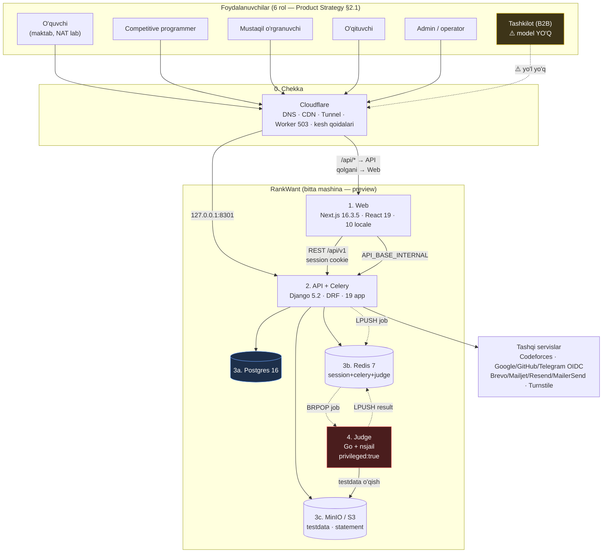

**FACT:** `O` (Tashkilot) uchun hech qanday model, rol yoki endpoint **yo'q** — B2B bugun faqat Classroom orqali bilvosita mavjud.

### 3.2 Container / Component

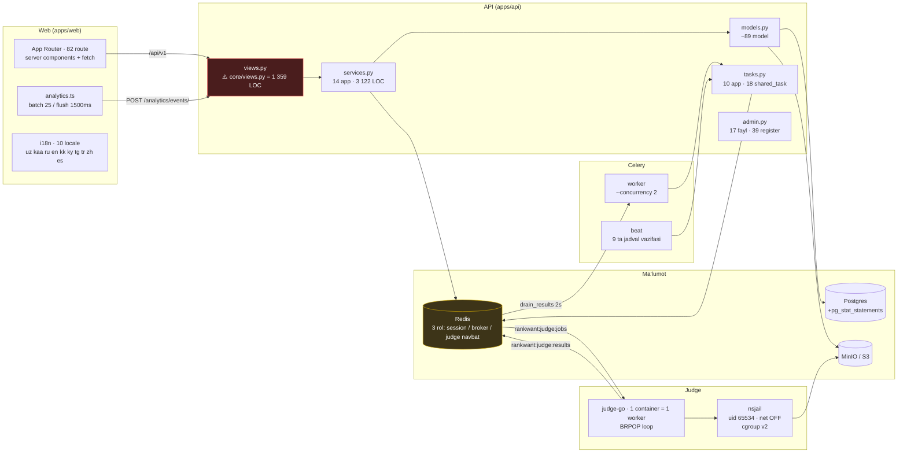

### 3.3 Qatlamlar bo'yicha As-Is (FACT/UNKNOWN)

| # | Qatlam | Bugungi holat | Dalil |
|---|---|---|---|
| 0 | **Chekka** | Cloudflare Tunnel; ochiq port yo'q; mehmon HTML keshi; `/api/*` → API, qolgani → Web. Rate-limit qoidasi **repo'da yo'q** | `tools/cf-guest-cache-rule.json`, `tools/cf-vary-accept-language.json`; `docs/10:161` |
| 1 | **Web** | Next.js 16.3.5 App Router, 82 route, 10 locale; SSR `API_BASE_INTERNAL`, brauzer `NEXT_PUBLIC_API_BASE`; session cookie + CSRF; PAT ishlatilmaydi (ADR-0008); birinchi tomon analytics (9 call site) | `apps/web/src/lib/api/client.ts`, `src/lib/analytics.ts`, `src/i18n/messages.ts:30-41` |
| 2 | **API** | Django 5.2, **bitta** `settings.py` (dev/prod ajratilmagan); faqat `/api/v1/`; 48 router + 93 path; gunicorn | `apps/api/config/settings.py`, `config/urls.py:6` |
| 3 | **Application / domain** | **14 app** da `services.py` (3 122 LOC); `selectors.py` **yo'q**, `signals.py` **yo'q**; `core/views.py` 1 359 LOC = god file; `profiles` domen modullariga bo'lingan (`external/teams/stats/catalog`), `services.py` emas | Explore agent o'lchovi |
| 4 | **Data** | Postgres 16; 87 migratsiya; `Attempt` 5 indeks; ledger `qvant/ledger.py` yagona yozuv yo'li; `AnalyticsEvent` mavjud | `qvant/ledger.py:64-131`, `core/models.py:619` |
| 5 | **Async / queue** | Celery worker (`--concurrency 2`) + beat (9 vazifa); **custom queue yo'q**; outbox/webhook/signal **yo'q**; `transaction.on_commit` faqat 2 joyda | `settings.py:411-470`; `profiles/views.py:278`, `ratings/services.py:123` |
| 6 | **Judge** | Go+nsjail; **1 container = 1 worker** (pool yo'q); PULL (Redis list); `DATABASE_URL` berilsa `exit 1`; `privileged:true` + `cgroup:host`; seccomp aniq belgilanmagan | `services/judge-go/main.go:24-115`, `sandbox.go:220-308`, `docker-compose.yml:192-193` |
| 7 | **AI** | **YO'Q** — 0 LLM integratsiya | grep |
| 8 | **Analytics** | `AnalyticsEvent(name, user, session_key, path, locale, props JSON)`; **9 call site**, asosan auth funnel; real/seed ajratish **yo'q** | `core/models.py:619`, `apps/web/src/lib/analytics.ts` |
| 9 | **Admin / backoffice** | Django admin, 39 register, 17 modul; `staff-*` 3 guruh (ADR-0025) | `core/groups.py`, `core/permissions.py:20-23` |
| 10 | **Infra** | 9 servis, bitta host, `restart: unless-stopped` (public overlay), **resource limit yo'q**, staging **yo'q** | `docker-compose.yml`, `docker-compose.public.yml` |
| 11 | **Observability** | `/api/v1/health/`, `/api/v1/slo/`, `tools/check_slo.py`; Sentry **ataylab yo'q** (CI bilan majburlangan); metrics store **yo'q**; log = Django console | `core/views.py:140-155`, `tools/check_decisions.py:1392-1418` |
| 12 | **Security** | PAT SHA-256 + session; 3 staff guruh; `tools/check_security_boundary.py` (INTERNAL_ONLY = judge/postgres/redis/minio); `security.yml` **`if: false`** | `core/auth.py:15`, `check_security_boundary.py:53`, `.github/workflows/security.yml:32` |
| 13 | **CI/CD** | `ci.yml` (api/web/judge/integrity), `deploy.yml` (qo'lda, self-hosted runner, contest oynasi tekshiruvi), `nightly.yml` (load/e2e/chaos/security/latency/coverage) | `.github/workflows/` |

### 3.4 Judge izolyatsiya — o'lchangan haqiqat

| Element | Qiymat | Dalil |
|---|---|---|
| Sandbox | nsjail, `--chroot /` (ro), `--bindmount <work>:/box`, `--cwd /box` | `sandbox.go:220-308` |
| User | `--user 65534 --group 65534` (nobody) | `sandbox.go:244-245` |
| Tarmoq | **`--iface_no_lo`** (tarmoq o'chirilgan) | `sandbox.go:272` |
| `/proc` | `--disable_proc` + bo'sh tmpfs (yoki `subset=pid,hidepid=invisible`) | `sandbox.go:258-266` |
| rlimit | fsize 16 MB · as 16 384 MB · cpu `cpuLimitSec` · nproc `processes+4` · time `wall+30` · nofile 64 | `sandbox.go:273-306` |
| cgroup v2 | `pids.max` · `memory.max` · `memory.swap.max=0`; ota-chegara pids 512, mem 4 GiB | `sandbox.go:349-366`, `:47-48` |
| Konteyner | **`privileged: true`** + **`cgroup: host`** | `docker-compose.yml:192-193` |
| seccomp | **aniq profil yo'q** (nsjail default) | UNKNOWN |
| DB credential | **yo'q** — `DATABASE_URL` berilsa process `exit 1` | `main.go:27-31` |
| Testdata | S3/MinIO, judge faqat `s3://bucket/key` ref oladi; 256 MB in-memory kesh | `store.go:15-98` |
| Verdict | 17 kod `protocol.go` da + API-only `verdicts.py` da; `RE` — legacy (18 163 qator) | `protocol.go:184-209`, `verdicts.py:8-51` |
| Crash | judge `RUNNING` holat yozmaydi → `reap_stuck` (60 s) bir marta qayta navbatga, keyin `DENIAL_OF_JUDGEMENT` | `judging/tasks.py:63-118` |
| Idempotentlik | `apply_result` `select_for_update` bilan | `judging/services.py:202-260` |

### 3.5 Deployment (As-Is)

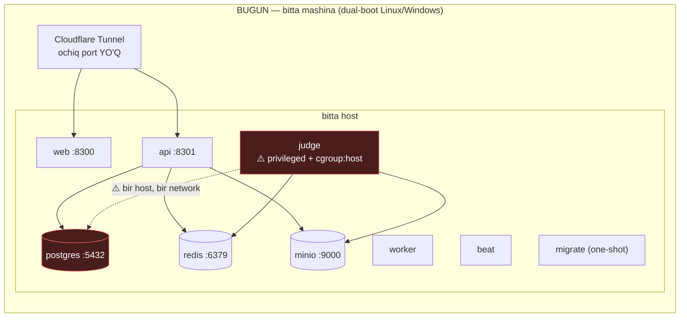

**FACT:** `docs/10-operations` bu holatni "ommaviy preview" deb ataydi va "production emas" deb yozadi (`docs/06:100-101`).
**FACT:** `compose/four-host/README.md` maqsad topologiyani **hujjatlashtiradi**, lekin u **bajariladigan compose fayl emas** — qurilmagan.
**FACT:** `docker-compose.replicas.yml` (web×2/api×2 + Caddy `origin-lb`) mavjud, lekin preview'ga qo'llanmaydi; **judge uchun replica yo'q**.

---

## 04. Architecture Problems / Gaps

### 4.1 PRODUCT ↔ REPOSITORY CONFLICT

Quyidagilarda Product Strategy va repository **bir-biriga zid**. Qaysi biri to'g'ri ekani **o'zboshimchalik bilan tanlanmagan** — har biri qaror talab qiladi.

---

#### CONFLICT-1 — NAT throttle: `60/min` yoki `1500/hour`?

| Tomon | Da'vo | Manba |
|---|---|---|
| **PRODUCT** | "anonim throttle **60 req/min/IP** → bir IP ortida 20 foydalanuvchidan **94% HTTP 429**" — P0 bloker, F73, risk #5 (score 20) | Product Strategy TL;DR, §3, §5.3, §12.1 |
| **DOCS** | "Anon throttle IP bo'yicha ishlaydi: `60/min`… 94% so'rovi `429` oldi" | `docs/10-operations/README.md:84-86`; `docs/08-technical-spec/README.md:44`; `docs/07-adr/0008:68` |
| **REPOSITORY** | `THROTTLE_ANON` standart qiymati = **`"1500/hour"`** (≈25/min), env orqali sozlanadi | `apps/api/config/settings.py:278-280` |
| **REPOSITORY (izoh)** | Kod izohi aynan shu muammoni tushuntiradi: *"Anon limiti IP bo'yicha, maktab kompyuter sinfi esa bitta tashqi IP dan chiqadi — 30 o'qituvchi dars boshida birdan kiradi. **Daqiqalik oyna shu portlashda uriladi, soatlik oyna esa o'tkazadi**"* | `settings.py:271-277` |

**INFERENCE:** 94%/429 o'lchovi **eski konfiguratsiyaga** (minute oynasi) tegishli. Kod **keyin o'zgargan** (`git log -S THROTTLE_ANON` → `a1aeb5f test(load): run k6 against the stack, and record the NAT throttle risk`, `9deb82f fix(api): stop one crawler from throttling the whole site`). Ya'ni F73 **qisman allaqachon tuzatilgan** bo'lishi mumkin — yoki o'lchov **eskirgan**.

**Nima qilinishi kerak (qaror emas, talab):** maktab-sinfi stsenariysi **qayta o'lchanishi** shart (20+ parallel user, bitta IP, joriy konfiguratsiya). O'lchovsiz F73 "P0 bloker" yoki "yopilgan" deb e'lon qilinmaydi.

**Bog'liq FACT:** throttling kodida uchta muhim himoya **allaqachon bor** — Product Strategy ularni hisobga olmagan:
- `TrustedClientIdent` — kalit `HTTP_CF_CONNECTING_IP` dan (mijoz yozadigan `X-Forwarded-For` dan **emas**) → sarlavha bilan chetlab o'tish **yopilgan** (`core/throttling.py:34-55`)
- `CacheOutageTolerant` — Redis yiqilsa **o'qish o'tadi**, yozish 503 (`:57-70`)
- `InternalRenderRate` — SSR uchun alohida, kengroq chegara (`:72+`)

---

#### CONFLICT-2 — `is_seeded`: North Star hisoblanmaydi

| Tomon | Da'vo |
|---|---|
| **PRODUCT** | North Star SQL: `WHERE verdict = 'AC' AND created_at >= NOW() - INTERVAL '7 days' AND **is_seeded = false**`. Strategy o'zi "OPEN QUESTION: `is_seeded` ustuni mavjudligi tasdiqlanmagan" deb belgilaydi |
| **REPOSITORY** | `is_seeded` **hech qayerda yo'q** — grep butun `apps/` bo'ylab faqat `.venv/…/faker/generator.py` da `_is_seeded` topadi. `Attempt` modelida bunday maydon yo'q |

**FACT:** North Star **bugun hisoblanmaydi**. Seed ajratishning yagona amaliy usuli — `neytron_` username prefiksi (`core/management/commands/seed_stress.py:26,51`) va email yo'qligi (`core/models.py:296` izohi: 10 068 import muallifda email yo'q). Bu **mo'rt va hujjatlashtirilmagan** usul.

**Arxitektura javobi:** 13-bo'limda `data origin` modeli taklif qilinadi (ADR 0030).

---

#### CONFLICT-3 — Staging: hujjatda bor, infratuzilmada yo'q

| Tomon | Da'vo | Manba |
|---|---|---|
| **DOCS** | "GitHub Actions: … → **staging deploy**"; "Staging — `staging.rankwant.uz` — production bilan bir xil topologiya, kichik"; "CI → staging → prod qo'lda tasdiqlash" | `docs/10-operations/README.md:378,730,960` |
| **DOCS (o'zi tan oladi)** | "⚠️ **Staging yo'q** — prod'ga chiqishdan oldin oraliq tekshiruv bosqichi yo'q"; "⚠️ **Nomuvofiqlik**: `10-operations` staging deploy deb yozadi, lekin staging muhiti mavjud emas" | `docs/06-architecture/README.md:117-123` |
| **REPOSITORY** | Staging uchun compose/env fayli **yo'q**; `deploy.yml` da faqat `environment: [staging, production]` input mavjud, lekin staging infratuzilmasi yo'q | `.github/workflows/deploy.yml:25-29` |

**FACT:** staging — **hujjat xatosi emas, yetishmagan komponent (GAP)**. Product Strategy F67 (P0) buni to'g'ri belgilagan.

---

#### CONFLICT-4 — Sentry: qurilsinmi yoki ataylab yo'qmi?

| Tomon | Da'vo |
|---|---|
| **PRODUCT** | F70 "Monitoring / Sentry" — `YO'Q`, **P1**, "quriladi" (§4.9, §5.3) |
| **REPOSITORY** | **Ataylab rad etilgan va CI bilan majburlangan.** `tools/check_decisions.py:1392-1418` — `sentry_sdk` import qilinsa yoki `requirements.lock` da `sentry-sdk` bo'lsa, **CI yiqiladi**. `core/views.py:146` izohi: *"Sentry yo'q (2026-09-19 qaror)"* |

**FACT:** bu **qaror to'qnashuvi**. Product Strategy "Sentry kerak" deydi; repo "Sentry kerakmas, SLO view yetarli" deb **kod bilan qulflagan**. Bu — **21-bo'limda ADR 0039** sifatida ochiq qaror sifatida qo'yiladi: monitoring **ehtiyoji** qabul qilinadi, **vosita** qayta ko'riladi (Sentry, self-hosted alternativa yoki mavjud SLO view + alert).

---

#### CONFLICT-5 — Judge izolyatsiya: ADR-0004 nima deydi va kod nima qiladi

| Tomon | Da'vo |
|---|---|
| **PRODUCT** | "F66 — judge `privileged:true` + `cgroup:host` — **ADR-0004'ga zid**" |
| **ADR-0004 (haqiqiy matni)** | "Xavfsizlik shartlari (muzokara qilinmaydi)": judge host **hech qachon API/DB bilan bir serverda emas**; tashqi tarmoq yopiq; foydalanuvchi kodi API hostida ishlamaydi; til obrazlari pin; **ommaviy launch oldidan tashqi audit majburiy**. Konteyner darajasidagi `privileged` **tilga olinmagan** |
| **REPOSITORY** | `privileged: true` + `cgroup: host` — izohi: *"nsjail namespace va cgroup uchun"* |

**INFERENCE (aniqlik uchun):** bu **so'zma-so'z zid emas** — ADR-0004 `privileged` haqida **jim**. Lekin:

1. `privileged: true` ADR-0004'ning **sababini** (Judge0 CVE → host root) bekor qiladi: konteyner host imtiyozlarini oladi, ya'ni nsjail escape → **host root**.
2. ADR-0004'ning **birinchi sharti** (alohida server) bugungi preview'da **bajarilmagan**: judge Postgres/Redis/MinIO bilan **bir hostda**. Yagona himoya — `DATABASE_URL` yo'qligi, kiruvchi port yo'qligi va har-ijro network namespace. Bu **yaxshi, lekin ADR-0004 talab qilgan chegarani bermaydi**.

**RECOMMENDATION:** bu "ADR-0004 zid" emas, **"ADR-0004 bo'shlig'i"** deb yozilsin va **ADR 0028** (judge privilege modeli) + **ADR 0029** (judge host ajratish) bilan yopilsin.

---

### 4.2 Arxitektura GAP'lari (ziddiyatsiz, lekin yetishmayotgan)

| ID | GAP | Dalil | Bog'liq P0/P1 |
|---|---|---|---|
| G1 | **Content integrity pipeline yo'q** — yashirin test, checker validatsiyasi, ref-solution regressiyasi bir joyda majburlanmaydi. Publish-time to'siq **bor** (yashirin testsiz e'lon qilinmaydi), lekin arxivdagi 1 222 masala va 200 checker mos emas | `docs/10-operations:127-130` | F09–F11 |
| G2 | **Judge worker pool yo'q** — 1 container = 1 worker, `main.go` bir oqimli loop | `main.go:74-114` | F72 |
| G3 | **Compile cache yo'q** — `total_ms` ning ~830 ms i kompilyatsiya; rejudge ham qaytadan kompilyatsiya qiladi | ADR-0004 | F72 |
| G4 | **Data origin mexanizmi yo'q** (CONFLICT-2) | grep | F53/F54 |
| G5 | **Event sxemasi kanonik emas** — `AnalyticsEvent.props` erkin JSON; `schema_version`, `event_id`, `subject`, `origin` yo'q; 9 call site | `core/models.py:619` | F53 |
| G6 | **Metric gate yo'q** — metrikalar `origin='real'` filtri bilan yozilganini tekshiradigan hech narsa yo'q | — | F53/F54 |
| G7 | **AI Gateway / policy enforcement yo'q** (AI umuman yo'q) | grep | F38/F39 |
| G8 | **Contest-rejim server-side enforcement yo'q** — chunki AI ham yo'q; lekin model **oldindan** kerak | — | F38/F12.2 |
| G9 | **Billing / Organization / Entitlement modellari yo'q** — `Classroom.owner` FK bor, `Organization` yo'q | `classroom/models.py:19` | F48/F51 |
| G10 | **Resource limit yo'q** — hech bir servisda `deploy.resources` / `mem_limit` / `cpus` yo'q; bitta servis hostni to'ldirishi mumkin | `docker-compose.yml` | F68 |
| G11 | **PITR / WAL archiving yo'q** — oylik `pg_dump` (RPO ≤30 kun), off-site R2 **default OFF** | `tools/backup.sh:24-28` | F69 |
| G12 | **Metrics store yo'q** — SLO view bor, lekin vaqt qatori, alerting, dashboard yo'q | `core/views.py:140-155` | F70 |
| G13 | **Object-level authorization izchil emas** — DRF `has_object_permission` **override topilmadi**; huquq imperativ tekshiriladi (`require_staff_group`, M2M) | Explore agent o'lchovi | — |
| G14 | **Bitta `settings.py`** — dev/prod/staging ajratilmagan; konfiguratsiya env orqali | `config/settings.py` | F67 |
| G15 | **`security.yml` o'chirilgan** — `if: false`; gitleaks/pip-audit/npm audit CI'da **ishlamaydi** | `.github/workflows/security.yml:32` | F65 |
| G16 | **Secrets dev-default'lari compose'da** — `POSTGRES_PASSWORD: dev`, `MINIO_ROOT_PASSWORD: devdevdev`, `S3_SECRET: devdevdev`, `DJANGO_SECRET_KEY` fallback `"dev-only-not-for-production"` | `docker-compose.yml:39,69,92,106,136,151,199`; `settings.py:22` | F74 |
| G17 | **Modul chegarasi majburlanmagan** — app'lar bir-birining `models`ini to'g'ridan-to'g'ri import qiladi; chegarani tekshiradigan gate yo'q | — | — |
| G18 | **Real concurrent submission capacity o'lchanmagan** — 2.4/s…8.0/s bench bor, lekin production yuk ostida emas | ADR-0004 (bench, prod emas) | F55 |

---

## 05. Architecture Principles

Mavjud 6 prinsip (`docs/01`) va Product Strategy'ning 12 prinsipi (7–12 yangi) **saqlanadi**. Arxitektura ularni **texnik qarorlar**ga aylantiradi:

| # | Arxitektura prinsipi | Texnik majburlash (enforcement) | Manba |
|---|---|---|---|
| **AP1** | **Ishonch zanjiri — yagona yo'l.** Verdict faqat content-integrity gate'dan o'tgan masala uchun "ishonchli" hisoblanadi | `Problem.readiness` holat mashinasi; graded contest'ni `<95%` coverage bilan **bloklash** | PS prinsip #7 |
| **AP2** | **Deterministik yadro, ehtimoliy chekka.** Judge **hech qachon** AI'ga bog'lanmaydi; AI verdikt yo'lida emas | AI app `judging` va `problems.models` ni import qilolmaydi (gate) | PS #11, ADR-0004 |
| **AP3** | **Least privilege — konteyner ham.** Har bir servis kerakli minimal imtiyoz bilan | `privileged:true` olib tashlanadi; cgroup systemd `Delegate=yes` orqali; `cap_drop: ALL` | ADR-0004 ruhi |
| **AP4** | **Chegara qulaylikdan ustun.** AI, judge, web **DB'ga to'g'ridan-to'g'ri tegmaydi** | Import gate + tarmoq siyosati + `check_security_boundary.py` kengaytmasi | PS #11 |
| **AP5** | **O'lchov — subsystem, keyin funksiya.** Har yangi funksiya **oldin** event + metrika oladi | Event envelope majburiy; metrika gate; feature flag'siz chiqarish yo'q | PS #8 |
| **AP6** | **Seed va real — ajratilgan.** Har metrika `origin='real'` filtri bilan | `origin` ustuni + query gate (CI) | PS #3 |
| **AP7** | **Modular monolith birinchi.** Extraction faqat **o'lchangan trigger** bilan | ADR talab; trigger: judge throughput >200/s yoki faol user >50k | `docs/research/2026-09-19-scale-50k` |
| **AP8** | **Fail-closed yozish, fail-open o'qish.** Kesh/DB uzilsa yozish to'xtaydi, o'qish davom etadi | `CacheOutageTolerant` (allaqachon bor) — naqsh sifatida qabul qilinadi | `core/throttling.py:57-70` |
| **AP9** | **Sir repoda emas.** Dev-default **faqat** dev'da, production'da majburiy | gitleaks CI'da + `check_env.py` + compose'da default yo'q | F74 |
| **AP10** | **Bir tomonlama eshik — ADR.** Qaytarib bo'lmaydigan qaror (schema, boundary, vendor) ADR'siz qabul qilinmaydi | `tools/check_decisions.py` naqshi kengaytiriladi | CONTRIBUTING |
| **AP11** | **Chegara majburlanmasa — chegara emas.** Har bir qoida **kod bilan** tekshiriladi, hujjat bilan emas | Gate skriptlar to'plami (`tools/check_*.py`) | repo naqshi |
| **AP12** | **Bajarib bo'lmaydigan va'da berilmaydi.** Foydalanuvchi tashqi AI'ini to'sib bo'lmaydi — bu ochiq tan olinadi | Contest AI policy "best-effort + flag + human review" | PS #10 |

---

## 06. Target Architecture

### 6.1 Target — 13 qatlam

| # | Qatlam | Mas'uliyat | Chegara | Ruxsat etilgan bog'liqlik | **TAQIQLANGAN** | Interfeys | Scaling |
|---|---|---|---|---|---|---|---|
| **L0** | **Client** | Render, i18n, UX, sessiya cookie uzatish | Biznes qoida yozmaydi | → L1 (faqat) | ❌ DB · ❌ judge · ❌ testdata · ❌ model provider (to'g'ridan-to'g'ri) | HTTPS + REST `/api/v1` | CDN (Cloudflare), statik kesh |
| **L1** | **API / Edge** | Marshrutlash, authN, throttling, kesh sarlavhalari | Qoida qarori **yo'q** (L2 ga) | → L2 | ❌ domen logikasi · ❌ ORM so'rovi (view'da) | OpenAPI 3 (contract gate) | gorizontal (gunicorn workers), Cloudflare cache |
| **L2** | **Application** | Use-case orkestratsiyasi, transaksiya chegarasi | **Yagona yozuv yo'li** | → L3, L5, L7 | ❌ to'g'ridan-to'g'ri SQL · ❌ HTTP tashqi chaqiruv (adapter orqali) | Python service funksiyalari (`services.py`) | vertikal (CPU), keyin gorizontal |
| **L3** | **Domain** | Entity, invariant, qoida | Framework-bilimsiz bo'lishga intiladi | → L4 | ❌ view · ❌ HTTP · ❌ tashqi SDK | Model metodlari, domain xizmatlari | — |
| **L4** | **Data** | Postgres (metadata, ledger, standings), Redis (kesh/sessiya/navbat), S3 (testdata/statement) | **Faqat L2/L3** | ← L2 | ❌ L0/L1 to'g'ridan-to'g'ri · ❌ judge (DB) · ❌ AI | ORM + migratsiya; S3 presigned | read replica (trigger bilan), partitioning (trigger bilan) |
| **L5** | **Async / Queue** | Celery (orkestr), beat (jadval), navbat semantikasi | At-least-once + idempotentlik | ← L2 → L6 | ❌ biznes qoida (task = orkestr) | Task imzosi + navbat nomi | worker gorizontal, navbat ajratish (trigger) |
| **L6** | **Judge** | Foydalanuvchi kodini izolyatsiyada ijro etish, verdict | **Deterministik, izolyatsiyalangan, AI'siz** | → Redis (job/result), S3 (testdata, **read-only**) | ❌ DB credential · ❌ kiruvchi port · ❌ tashqi internet · ❌ AI · ❌ API'ga HTTP | `protocol.md` (JSON job/result) | **host** qo'shish (linear emas — 8w=8.0/s) |
| **L7** | **AI** | Feedback, mentor, tarjima, anti-cheat flag | **Faqat ruxsat-cheklangan interfeys** | → AI Gateway → Model Adapter → model | ❌ judge host · ❌ DB · ❌ testdata · ❌ contest ichida | AI Gateway API (internal) | GPU host (trigger bilan), navbat + kesh |
| **L8** | **Analytics** | Event qabul, saqlash, agregatsiya, funnel | Append-only, PII-minimal | ← L0/L1/L2 | ❌ domen yozuvi (analytics yozuvni bloklamaydi) | `POST /analytics/events/` + envelope | batch ingest, partition (trigger) |
| **L9** | **Admin / Backoffice** | Operatsion boshqaruv, moderatsiya, audit | Staff guruh + object ownership | → L2 (service orqali) | ❌ to'g'ridan-to'g'ri SQL · ❌ judge host | Django admin + `staff/*` API | — (past hajm) |
| **L10** | **Infra** | Host, tarmoq, sir, backup, deploy | Declarative | — | ❌ kod ichida sir | docker compose (4-host), CI/CD | host qo'shish |
| **L11** | **Observability** | SLO, metrika, log, alert, trace | Cross-cutting | ← hamma | ❌ domen holatini o'zgartirish | `/health/`, `/slo/`, metrika eksport | markazlashtirilgan (trigger: 4-host) |
| **L12** | **Security** | AuthN/Z, RBAC, chegara, audit | Cross-cutting, **majburiy** | — | ❌ "keyin qo'shamiz" | Permission klasslar + boundary gate | — |

### 6.2 Target — konteyner/komponent diagrammasi

```mermaid
graph TB
    subgraph L0["L0 · Client"]
        B["Brauzer<br/>Next.js SSR + hydrate"]
        M["Mobil / CLI / bot<br/>PAT orqali (kelajak)"]
    end

    subgraph L1["L1 · Edge + API"]
        CF["Cloudflare<br/>CDN · Tunnel · WAF · kesh"]
        APIP["Django/DRF<br/>/api/v1 · authN · throttle"]
    end

    subgraph L2L3["L2/L3 · Application + Domain"]
        SVC["services.py (yagona yozuv yo'li)<br/>+ domen invariantlar"]
    end

    subgraph L5["L5 · Async"]
        CEL["Celery worker + beat<br/>navbat: default / judge_results / analytics"]
    end

    subgraph L6["L6 · Judge (alohida host ×N)"]
        JG["judge-go pool<br/>BRPOP → judge → LPUSH"]
        NSJ["nsjail (userns + seccomp)<br/>net OFF · cgroup v2"]
    end

    subgraph L7["L7 · AI (yangi)"]
        AIG["AI Gateway<br/>policy · limit · kesh · audit"]
        ADP["Model Adapter"]
        LOC["Lokal model (vLLM/Ollama)"]
        CLD["Bulut model<br/>(faqat consent + zero-retention)"]
    end

    subgraph L8["L8 · Analytics"]
        EV["Event ingest"]
        EVS[("Event store<br/>origin: real/demo")]
    end

    subgraph L4["L4 · Data"]
        PG[("Postgres<br/>+ PITR")]
        RD[("Redis<br/>navbat/kesh/sessiya")]
        S3[("S3/R2<br/>testdata (cheklangan)"))
    end

    subgraph L11["L11 · Observability"]
        OBS["metrika · log · alert · SLO"]
    end

    B --> CF --> APIP
    M --> CF
    APIP --> SVC
    SVC --> PG & RD & S3
    SVC --> CEL
    CEL --> RD
    RD -->|"jobs"| JG
    JG --> NSJ
    NSJ -->|"testdata (ro)"| S3
    JG -->|"results"| RD
    B -->|"event"| EV
    APIP -->|"event"| EV
    EV --> EVS
    SVC -.->|"policy-checked request"| AIG
    AIG --> ADP --> LOC
    ADP --> CLD
    SVC --> OBS
    JG --> OBS
    AIG --> OBS

    AIG -. "❌ DB yo'q" .-> PG
    AIG -. "❌ testdata yo'q" .-> S3
    AIG -. "❌ judge yo'q" .-> JG

    style AIG fill:#1d3a2a,stroke:#4ade80,color:#fff
    style JG fill:#4a1d1d,stroke:#ff6b6b,color:#fff
    style PG fill:#1d2f4a,stroke:#6ba3ff,color:#fff
```

### 6.3 Qatlam bo'yicha target qarorlar

| Qatlam | Target qaror | Sabab (dalil) |
|---|---|---|
| L0 | Web o'zgartirilmaydi; **instrumentatsiya kengaytiriladi** (9 → ~25 call site) | Funnel yo'q (FACT) |
| L1 | `/api/v1` saqlanadi; **OpenAPI contract gate** kuchaytiriladi; throttling **identity-aware** bo'ladi | ADR-0008; CONFLICT-1 |
| L2 | **`core/views.py` (1 359 LOC) bo'linadi** → `services.py`; **barcha yozuv service orqali** | Naqsh allaqachon bor (14 app) |
| L3 | Domen invariantlar modelga/`services` ga; `selectors.py` kerak bo'lsa kiritiladi | `selectors.py` yo'q (FACT) |
| L4 | `origin` ustuni; PITR; `Attempt` partitioning **trigger bilan**; read replica **trigger bilan** | G4, G11 |
| L5 | **Navbatlar ajratiladi**: `default` / `judge_results` / `analytics`; `judge_results` prioritetli | Bitta navbat (FACT) |
| L6 | **Host ajratish + pool + compile cache + seccomp + userns** | A1, G2, G3 |
| L7 | **Yangi**: AI Gateway (ADR 0033…0036) | AI = 0 (FACT) |
| L8 | Envelope + `origin` + metric gate | G5, G6 |
| L9 | Audit log kengaytiriladi; object-level permission izchillashtiriladi | G13 |
| L10 | 4-host; staging; secrets; resource limitlar | G10, G14, G16, CONFLICT-3 |
| L11 | SLO view **saqlanadi** + metrika eksport + alert kanali | CONFLICT-4 (Sentry qayta ko'riladi) |
| L12 | Boundary gate kengaytiriladi; `security.yml` yoqiladi | G15 |

---

## 07. Domain / Module Boundaries

### 7.1 Bounded context'lar (repository'dagi **haqiqiy** app'lar asosida)

**FACT:** 19 Django app mavjud. Quyidagi dekompozitsiya — ularning **haqiqiy domen modeliga** mos, majburiy emas: har bir kontekst **bir yoki bir nechta mavjud app**dan iborat. Yangi app faqat `AI`, `Analytics`, `Billing` uchun taklif qilinadi (uchalasida **kod yo'q**).

| # | Bounded context | Mavjud app(lar) | Mas'uliyat | Egallagan ma'lumot | Public interfeys | Bog'liqlik | Event'lar | Xavfsizlik chegarasi |
|---|---|---|---|---|---|---|---|---|
| **BC1** | **Identity & Access** | `core` (User, ApiToken, UserSession, SocialAccount, UsernameHistory, School) | AuthN, sessiya, PAT, OIDC, rollar, throttling asosi | `User`, `ApiToken`, `UserSession`, `SocialAccount` | `core.services`, `core.permissions`, `core.throttling` | — | `user.registered`, `user.logged_in`, `token.issued` | **Eng yuqori** — barcha authz shu yerga tayanadi |
| **BC2** | **Problem Catalog & Content** | `problems` (16 model), `content`, `roadmap`, `blog`, `updates` | Masala CRUD, statement, testdata ref, editorial, maqola, roadmap | `Problem`, `TestCase`, `Validator`, `ReferenceSolution`, `Topic`, `Article`, `Roadmap` | `problems.services`, `problems.selectors` (yangi) | BC1 | `problem.published`, `problem.validated`, `editorial.unlocked` | **Testdata chegarasi** — faqat judge o'qiy oladi |
| **BC3** | **Submission & Judging** | `judging` (Attempt, AttemptTestResult, CustomRun) | Submit qabul, navbatga qo'yish, verdict yozish, rejudge | `Attempt`, `AttemptTestResult`, `CustomRun` | `judging.services`, `judging.provider.JudgeProvider` | BC2, BC1, L6 | `attempt.created`, `attempt.judged`, `verdict.recorded` | **Verdikt yaxlitligi** — yagona yozuv yo'li |
| **BC4** | **Contest & Competition** | `contests`, `arena`, `duels`, `tournaments`, `hackathons`, `hacks` | Contest, standings, sertifikat, duel/arena/turnir, hack | `Contest`, `ContestProblem`, `ContestRegistration`, `Standing`, `Certificate`, `Hack*` | `contests.services` | BC3, BC5, BC1 | `contest.joined`, `contest.finalized`, `standing.updated` | **Contest rejimi manbasi** — AI policy shu yerdan o'qiydi |
| **BC5** | **Rating & Progression** | `ratings`, `qvant`, `profiles` (achievements/titles) | 4 reyting, ledger, quest/streak, unvon | `RatingHistory`, `UserSolvedProblem`, `QvantWallet`, `QvantTransaction`, `UserAchievement` | `ratings.services`, `qvant.ledger` | BC3, BC4, BC1 | `rating.changed`, `qvant.credited`, `achievement.awarded` | **Ledger** — balans to'g'ridan-to'g'ri yozilmaydi (ADR-0002) |
| **BC6** | **Learning** | `roadmap`, `quizzes`, `content` | Roadmap progress, quiz, o'quv kontent | `Roadmap`, `RoadmapStep`, `Quiz*` | `roadmap.services` | BC2, BC5 | `roadmap.step_completed`, `quiz.submitted` | — |
| **BC7** | **Community & Notifications** | `blog`, `updates`, `notifications` | Post, changelog, in-app/telegram bildirishnoma | `Post`, `SystemUpdate`, `Notification` | `notifications.services` | BC1, BC2 | `notification.sent`, `post.published` | PII minimal |
| **BC8** | **Classroom / B2B** | `classroom` (Classroom, ClassroomMember, Assignment) | Sinf, a'zolik, topshiriq, progress | `Classroom`, `ClassroomMember`, `Assignment` | `classroom.services` | BC1, BC2, BC3 | `classroom.created`, `assignment.created`, `assignment.progress` | **Bolalar ma'lumoti** — eng yuqori maxfiylik |
| **BC9** | **AI** ⭐yangi | `ai` (yo'q → taklif) | Feedback, mentor, tarjima, anti-cheat flag | `AiRequest`, `AiResponse`, `AiPolicyDecision`, `AiUsage`, `PromptVersion` | **AI Gateway** (internal API) | BC3 (**read-only DTO**), BC4 (rejim), BC2 (**faqat public statement**) | `ai.requested`, `ai.responded`, `ai.denied`, `ai.flagged` | **❌ DB · ❌ testdata · ❌ judge** |
| **BC10** | **Analytics & Instrumentation** ⭐yangi | `analytics` (yoki `core.AnalyticsEvent` kengaytmasi) | Event ingest, saqlash, funnel, agregat | `Event`, `MetricSnapshot`, `DataOrigin` | `POST /analytics/events/` | BC1 (identity), L0 | hamma event | PII-minimal, IP saqlanmaydi |
| **BC11** | **Billing & Entitlement** ⭐yangi | `billing` (yo'q → taklif) | Obuna, entitlement, invoice, to'lov | `Subscription`, `Plan`, `Entitlement`, `Invoice`, `PaymentEvent` | `billing.services` | BC1, BC8 | `subscription.activated`, `entitlement.granted`, `invoice.paid` | **To'lov chegarasi** — Qvant'dan **butunlay ajratilgan** |
| **BC12** | **Administration** | `*/staff_views.py`, `*/admin.py`, `core.groups` | Operatsion boshqaruv, moderatsiya, audit | `AuditLog` (yangi), staff guruhlar | `staff/*` API + Django admin | hamma BC (service orqali) | `admin.action`, `moderation.decision` | Staff guruh + object ownership (ADR-0025) |

### 7.2 Dependency Map

```mermaid
graph TD
    BC1["BC1 Identity & Access<br/>(core)"]
    BC2["BC2 Problem Catalog<br/>(problems, content)"]
    BC3["BC3 Submission & Judging<br/>(judging)"]
    BC4["BC4 Contest<br/>(contests, arena, duels...)"]
    BC5["BC5 Rating & Progression<br/>(ratings, qvant, profiles)"]
    BC6["BC6 Learning<br/>(roadmap, quizzes)"]
    BC7["BC7 Community<br/>(blog, updates, notifications)"]
    BC8["BC8 Classroom / B2B<br/>(classroom)"]
    BC9["BC9 AI ⭐<br/>(ai — yangi)"]
    BC10["BC10 Analytics ⭐<br/>(analytics — yangi)"]
    BC11["BC11 Billing ⭐<br/>(billing — yangi)"]
    BC12["BC12 Administration"]

    BC2 --> BC1
    BC3 --> BC1
    BC3 --> BC2
    BC4 --> BC3
    BC4 --> BC5
    BC4 --> BC1
    BC5 --> BC3
    BC5 --> BC1
    BC6 --> BC2
    BC6 --> BC5
    BC7 --> BC1
    BC7 --> BC2
    BC8 --> BC1
    BC8 --> BC2
    BC8 --> BC3
    BC9 -.->|"read-only DTO"| BC3
    BC9 -.->|"rejim so'rovi"| BC4
    BC9 -.->|"public statement"| BC2
    BC11 --> BC1
    BC11 --> BC8
    BC12 -.->|"service orqali"| BC1
    BC12 -.-> BC2
    BC12 -.-> BC3

    BC9 -. "❌ to'g'ridan-to'g'ri" .-> BC2
    BC9 -. "❌ DB" .-> BC1
    BC10 --> BC1

    style BC9 fill:#1d3a2a,stroke:#4ade80,color:#fff
    style BC11 fill:#2a1d3a,stroke:#a78bfa,color:#fff
    style BC1 fill:#1d2f4a,stroke:#6ba3ff,color:#fff
```

**FACT:** bugun bu bog'liqliklar **majburlanmagan** — app'lar bir-birining `models`ini to'g'ridan-to'g'ri import qiladi. **RECOMMENDATION:** `tools/check_architecture.py` (ADR 0042) — import allowlist gate.

---

## 08. Dependency Rules

### 8.1 Ruxsat etilgan yo'nalish

```text
L0 Client
   ↓ (faqat HTTP)
L1 API
   ↓
L2 Application (services)
   ↓
L3 Domain
   ↓
L4 Data

L2 ──→ L5 Async ──→ L6 Judge
L2 ──→ L7 AI (faqat Gateway orqali)
L0/L1/L2 ──→ L8 Analytics (fire-and-forget)
```

**Qoida:** bog'liqlik **faqat pastga** (yuqoridagi ro'yxat bo'yicha) yoki **belgilangan lateral** yo'nalishda (L2→L5, L2→L7). **Yuqoriga** bog'liqlik (L4→L2) **taqiqlanadi**.

### 8.2 Modul darajasida MUST / MUST NOT

| Ruxsat (MUST) | Taqiq (MUST NOT) |
|---|---|
| `judging` → `problems.services` (masala + testdata ref olish) | `judging` → `problems.models` to'g'ridan-to'g'ri (service orqali) |
| `contests` → `judging.services` (submit) | `contests` → `judging.models.Attempt` to'g'ridan-to'g'ri |
| `ratings` → `judging` (verdict o'qish) | `ratings` → `judging` yozuv yo'li |
| `ai` → AI Gateway (internal HTTP) | `ai` → **DB** (`DATABASE_URL` umuman berilmaydi) |
| `ai` → AI Gateway → Context Builder (whitelisted DTO) | `ai` → **`problems.models.TestCase`** (testdata) |
| `analytics` → `core` (identity o'qish) | `analytics` → domen yozuvi (analytics yozuvni bloklamaydi) |
| `billing` → `core`, `classroom` (entitlement) | `billing` → **`qvant.ledger`** (aralashtirish) |
| Web → `/api/v1` (REST) | Web → **DB** to'g'ridan-to'g'ri |
| Admin → `services` | Admin → to'g'ridan-to'g'ri SQL / `models.save()` |

### 8.3 Eng muhim TAQIQLAR (Product Strategy'dan + repo dalilidan)

```text
AI
  ❌ judge host'ga kirish          — ADR-0004 chegarasi; PS prinsip #11
  ❌ DB'ga to'g'ridan-to'g'ri       — DATABASE_URL berilmaydi (naqsh: judge)
  ❌ testdata'ga to'g'ridan-to'g'ri — yashirin test = integrity aktivi
  ❌ contest ichida ishlash         — PS #9; Codeforces naqshi (REPORT §6.1)
  ❌ verdikt yo'lida bo'lish        — AP2 (deterministik yadro)

Judge
  ❌ tashqi internet               — `--iface_no_lo` (allaqachon bor)
  ❌ DB credential                 — `main.go:27-31` (allaqachon bor)
  ❌ kiruvchi port                 — PULL protokoli (allaqachon bor)
  ❌ AI chaqiruvi                  — yangi qoida (ADR 0028)

Frontend
  ❌ DB'ga to'g'ridan-to'g'ri      — API-first (ADR-0008)
  ❌ judge'ga to'g'ridan-to'g'ri   — hozir ham yo'q

Billing
  ❌ Qvant bilan aralashish        — PS F48: "Qvant'dan AJRATILGAN"
```

### 8.4 Majburlash mexanizmi (enforcement)

| Qoida | Mexanizm | Holat |
|---|---|---|
| Judge: DB credential yo'q | `main.go:27-31` `exit 1` + `tools/check_security_boundary.py:210-213` | ✅ **bor** |
| Judge: kiruvchi port yo'q | `check_security_boundary.py:182,219-220` (`INTERNAL_ONLY`) | ✅ **bor** |
| Judge: tashqi tarmoq yo'q | nsjail `--iface_no_lo` | ✅ **bor** |
| Judge: privileged yo'q | `check_security_boundary.py` kengaytmasi | ❌ **GAP** → ADR 0028 |
| AI: DB/testdata yo'q | `tools/check_ai_boundary.py` (yangi) | ❌ **GAP** |
| Modul: import allowlist | `tools/check_architecture.py` (yangi) | ❌ **GAP** |
| Metrika: `origin` filtri | `tools/check_metrics.py` (yangi) | ❌ **GAP** |
| Sir: repoda yo'q | gitleaks CI'da (`security.yml` yoqilishi shart) | ⚠️ **o'chirilgan** |

**AP11:** chegara hujjat bilan emas, **gate skript bilan** majburlanadi. Bu repo'ning allaqachon ishlatadigan naqshi (`check_docs.py`, `check_decisions.py`, `check_security_boundary.py`, `check_i18n.py`, `check_env.py`) — yangi qoidalar **shu naqshga** qo'shiladi.

---

## 09. Data Architecture

### 9.1 Kanonik entity'lar va egalik

| Entity | App | Egasi (BC) | Muhim izoh |
|---|---|---|---|
| `User`, `ApiToken`, `UserSession`, `SocialAccount`, `UsernameHistory`, `School` | `core` | BC1 | `AUTH_USER_MODEL = core.User`; 4 reyting ustuni (`rating_skills/contest/activity/challenges`) |
| `Problem`, `Topic`, `Language`, `Subtask`, `TestCase`, `ProblemLanguage`, `SimilarProblem`, `Validator`, `ReferenceSolution`, `ProblemRating`, `ProblemVote`, `EditorialUnlock`, `Favourite`, `ProblemReport` | `problems` | BC2 | **16 model** — eng katta app |
| `Attempt`, `AttemptTestResult`, `CustomRun` | `judging` | BC3 | `Attempt` da 5 indeks |
| `Contest`, `ContestProblem`, `ContestRegistration`, `Standing`, `Certificate` | `contests` | BC4 | |
| `RatingHistory`, `UserSolvedProblem` | `ratings` | BC5 | `RatingHistory` — **sabab bilan** (append-only) |
| `QvantWallet`, `QvantTransaction`, `QvantQuest`, `UserQuestCompletion`, `ShopItem`, `UserInventory` | `qvant` | BC5 | Ledger — **o'zgarmas** |
| `Classroom`, `ClassroomMember`, `Assignment` | `classroom` | BC8 | `owner` FK; **`Organization` yo'q** |
| `Hack`, `HackRoom`, `HackRoomMember`, `HackLock` | `hacks` | BC4 | |
| `UserAchievement` | `profiles` | BC5 | Unvon: `User.rank_title`, `max_rank_title` |
| `AnalyticsEvent` | `core` | BC10 | `props` erkin JSON |
| `SystemUpdateTranslation` | `updates` | BC7 | **Yagona haqiqiy tarjima jadvali** |

### 9.2 Append-only / audit jadvallari (FACT — allaqachon to'g'ri)

| Jadval | Kafolat | Dalil |
|---|---|---|
| `RatingHistory` | Har o'zgarish **sababi bilan**; `value_before/after/delta/reason`; indeks `(user, rating_type, -created_at)` | `ratings/models.py:43` |
| `QvantTransaction` | *"Ledger — o'zgarmas yozuv. O'chirilmaydi, tuzatilmaydi"* | `qvant/models.py:30` |
| Ledger invariant | Balans **faqat** `qvant/ledger.py` orqali: `credit()` `:64-103`, `debit()` `:106-131`, ikkalasi `@transaction.atomic`; `select_for_update` `:44,85,118,172`; kunlik cap `DAILY_EARN_CAP = 100`; `verify_balance()` `:197` | ADR-0002 ✅ **bajarilgan** |

**INFERENCE:** bu **arxitekturaning eng kuchli qismi**. Product Strategy'ning "shaffof reyting" differensiatori (#3) texnik jihatdan **asoslangan** — bu o'zgartirilmasligi kerak, faqat **kengaytirilishi** kerak (audit log, AI usage).

### 9.3 Muammolar → Target → Migratsiya

| # | Current | Problem | Target | Migratsiya strategiyasi |
|---|---|---|---|---|
| **D1** | Seed va real foydalanuvchi ajratilmagan; faqat `neytron_` prefiksi + email yo'qligi | North Star va **barcha** metrikalar iflos; qarorlar seed data ustida | `User.origin` enum: `real` · `demo` · `imported` · `staff`; `Attempt.origin` denormalizatsiya (o'qish tezligi uchun) | ① nullable ustun qo'shish → ② backfill (`neytron_` prefiksi + email yo'q + seed command audit) → ③ default `real`, `NOT NULL` → ④ metrikalarni yangilash → ⑤ prefiks evristikasini **o'chirish** (kod izohida saqlanadi). **Har qadam alohida deploy** (`docs/06:139-141` qoidasi: `add → backfill → switch → drop`) |
| **D2** | `AnalyticsEvent.props` erkin JSON; `schema_version`, `event_id`, `subject`, `origin` yo'q | Event'lar birlashtirilmaydi; idempotentlik yo'q; segmentatsiya yo'q | Kanonik envelope (13-bo'lim) | ① `event_id` (uuid, unique) + `schema_version` + `origin` + `subject_type/subject_id` ustunlari → ② ingest'da envelope validatsiyasi (eski yozuvlar `schema_version=0`) → ③ `props` saqlanadi (orqaga mos) |
| **D3** | `Problem` da readiness holati yo'q; publish-time to'siq **qisman** bor | 1 222 masala "published" lekin "unreliable"; arxiv remediatsiyasi kuzatilmaydi | `Problem.readiness`: `draft` → `validated` → `published`; `ContentQualitySnapshot` (kunlik metrika) | ① readiness maydoni → ② backfill: mavjud `is_public=True` masalalar uchun `validated` faqat ≥5 non-sample test bo'lsa, aks holda `legacy_unverified` → ③ graded contest gate → ④ remediatsiya dashboard |
| **D4** | `Topic` tarjimasi 3 ustun (`name_uz/ru/en`), `Problem.statement_locale` **bitta** til | "10 til" **UI** uchun; kontent 3 til. `docs/01` "145 mavzu faqat uz/ru/en" (FACT) | `ContentTranslation(content_type, object_id, field, locale, text, source, reviewed_by)` — umumiy tarjima jadvali | ① yangi jadval → ② `Topic.name_*` dan ko'chirish (backfill) → ③ o'qish ikkala joydan (dual-read) → ④ `name_*` ustunlari **keyin** (alohida deploy) → ⑤ AI tarjima (BC9) shu jadvalga yozadi, `reviewed_by` majburiy |
| **D5** | `ReferenceSolution` — `Problem` ga **OneToOne** (ADR-0021) | Per-test etalon yo'q; subtask/partial grading uchun har test uchun etalon kerak bo'lishi mumkin | `ReferenceSolution` **per-subtask** yoki `TestCase.expected_ref` (ADR-0010 naqshiga mos) | ADR qarori talab (ADR-0010 kengaytmasi); backfill: mavjud OneToOne → asosiy subtask |
| **D6** | Testdata bitta bucket + bitta uzoq muddatli kalit (`S3_SECRET: devdevdev`) | Judge buzilsa **butun** testdata; sir repoda | Per-problem prefiks + qisqa muddatli credential (presigned yoki STS) | ① kalitni aylantirish → ② prefiks siyosati → ③ presigned/STS → ④ eski kalitni bekor qilish |
| **D7** | `Attempt` — 384 569 qator, 5 indeks | Trigger'siz partitioning; hozir muammo emas | Partitioning **trigger bilan** (jadval > 10M qator YOKI so'rov p95 > 200 ms) | **Hozir qilinmaydi** — AP7 (o'lchangan trigger) |
| **D8** | Denormalizatsiya: `Problem.solved_count/attempt_count/view_count` | Sync mexanizmi hujjatlashtirilmagan (Product Strategy §12.4 ochiq savoli) | `services` orqali yagona yangilash yo'li + `verify_counters` management command | ① audit command → ② yagona yo'l → ③ kunlik tekshiruv |

### 9.4 Data layering qarorlari

| Qaror | Qiymat |
|---|---|
| Postgres | **metadata + ledger + standings** — transaksion holat |
| Redis | **3 rol bir instansda** (session / Celery broker / judge navbat) — `docs/06:147-148` buni **assumption** deb belgilaydi. **RECOMMENDATION:** trigger bilan ajratish: navbat uzunligi > 1 000 YOKI Redis CPU > 70% YOKI session eviction hodisasi |
| S3/R2 | **statement + testdata + avatar** — katta obyektlar |
| Event store | **Postgres** (boshlang'ich) — hajm o'ssa ajratish (trigger: > 50M event yoki agregat so'rov p95 > 1 s) |
| Analytics DB | **yo'q** — olib tashlangan (Product Strategy out-of-scope: Kafka/RabbitMQ trigger bilan) |

---

## 10. API Architecture

### 10.1 Existing API audit (FACT)

| Element | Holat | Dalil |
|---|---|---|
| Versiya | Faqat `/api/v1/`; v2 yo'q, header negotiation yo'q | `config/urls.py:6` |
| Marshrut | 48 `router.register` + 93 `path()`; prefikslar: `auth/ me/ users/ problems/ contests/ hacks/ attempts/ arena/ duels/ tournaments/ hackathons/ quizzes/ classrooms/ qvant/ notifications/ updates/ platform-roadmap/ posts/ articles/ roadmaps/ teams/ staff/*` | app `urls.py` lar |
| Pagination | `StandardPagination` page_size **25**, max **100**; `TimeCursorPagination` vaqt qatorlari uchun | `core/pagination.py:10-13` |
| Throttling | 12 scope: `anon 1500/hour` · `anon_internal 20000/hour` · `user 300/min` · `submit 6/min` · `hack 10/min` · `export 3/hour` · `password_reset 20/hour` · `register 40/hour` · `username_check 120/hour` · `account_change 20/hour` · `avatar 30/hour` · `analytics 240/hour` | `settings.py:278-314` |
| Auth | PAT (`Bearer rw_…`, SHA-256, scope `read` · `submit` · `contest:manage`) **birinchi**, keyin session | `settings.py:241-244` |
| Authorization | 3 staff guruh + permission klasslar; **object-level DRF override topilmadi** | `core/permissions.py:46-99` |
| Error model | DRF standart; web tomon `ApiError` + `Retry-After` | `apps/web/src/lib/api/client.ts` |
| Idempotency | **E'lon qilinmagan** | — |
| Async operatsiya | Submit → 201 + attempt id; natija polling/SSE orqali | `judging/views.py` |
| Contract | OpenAPI CI'da (`drf-spectacular`) | `ci.yml` api job |

### 10.2 Target API tuzilmasi

| Qoida | Qaror | Sabab |
|---|---|---|
| **Versiya** | `/api/v1/` **saqlanadi**. v2 faqat ADR bilan. Deprecation: `Sunset` + `Deprecation` sarlavhalari, kamida 2 reliz oldin e'lon | 82 web route + tashqi bot'lar v1 ga bog'langan (FACT) |
| **Resurs chegaralari** | Guruhlar: `/problems` (katalog) · `/attempts` (submit — **nom saqlanadi**, `submissions` **alias** qo'shiladi) · `/contests` · `/classrooms` · `/ai` (yangi, internal) · `/analytics` · `/staff` | Nomni o'zgartirish **breaking** — `docs/06:139` rollback qoidasi buziladi |
| **AuthN** | O'zgarmaydi: session (web) + PAT (API/bot) | ADR-0008 |
| **AuthZ** | Staff guruhlar saqlanadi; **object-level permission izchillashtiriladi**: har `staff/*` va foydalanuvchi obyekti uchun DRF `has_object_permission` yoki service-darajali tekshiruv **majburiy** | G13 |
| **Pagination** | Saqlanadi (25/100). Katta ro'yxatlar (submissions, standings) uchun cursor **majburiy** | 384k attempt (FACT) |
| **Filtering** | `django-filter` sxemasi OpenAPI'da e'lon qilinadi (hozir qisman) | — |
| **Error model** | Standart DRF **+** har xatoda `code` (mashina o'qiy oladigan): `{"detail": "...", "code": "RATE_LIMITED"}`. 429 da `Retry-After` **majburiy** | Web tomon allaqachon `Retry-After` o'qiydi (FACT) |
| **Idempotency** | `Idempotency-Key` sarlavhasi **majburiy** `POST /attempts/` va `POST /billing/*` uchun. Kalit 24 soat saqlanadi; takror so'rov **bir xil javob** qaytaradi | `reap_stuck` mavjud (FACT) — lekin **mijoz** tomonidagi takroriy submit hali himoyasiz |
| **Rate limiting** | Identity-aware (17-bo'lim): o'qish saxiy, yozish qat'iy | CONFLICT-1 |
| **Async** | Submit: `201 + {id, status:"PENDING"}` (saqlanadi). **Yangi:** `GET /attempts/{id}/events` — SSE stream (`PENDING → RUNNING → verdict`). Polling **saqlanadi** (fallback) | SSE `docs/06:46` da allaqachon tanlangan |
| **Contract gate** | OpenAPI diff CI'da **breaking change** uchun PR'ni bloklaydi | `ci.yml` da qisman bor |

### 10.3 API guruhlari bo'yicha target chegaralar

| Guruh | Egasi (BC) | Throttle scope | Maxsus qoida |
|---|---|---|---|
| `/auth`, `/me`, `/users` | BC1 | `anon` / `user` / `register` / `username_check` / `account_change` | Register NAT-aware (17-bo'lim) |
| `/problems`, `/articles`, `/roadmaps`, `/posts` | BC2, BC6, BC7 | `anon` (o'qish) | Mehmon kesh (Cloudflare) — keshdan keyin throttle **hisoblanmaydi** |
| `/attempts` | BC3 | `submit 6/min` (yozish) · `user 300/min` (o'qish) | `Idempotency-Key` majburiy |
| `/contests`, `/arena`, `/duels`, `/tournaments`, `/hackathons` | BC4 | `user`, `hack 10/min` | Standings → CDN |
| `/classrooms` | BC8 | **`org:<id>` bucket** (17-bo'lim) | Bolalar ma'lumoti — audit majburiy |
| `/ai/*` ⭐ | BC9 | `user` + **kunlik byudjet** | **Practice-only**, server-side deny contest'da |
| `/analytics/events` | BC10 | `analytics 240/hour` | Batch; `origin` majburiy |
| `/staff/*` | BC12 | `user` | Staff guruh + object ownership + audit log |
| `/billing/*` ⭐ | BC11 | `user` | `Idempotency-Key` majburiy; webhook alohida auth |

---

## 11. Judge Architecture

### 11.1 Submission → Verdict oqimi (As-Is, o'lchangan)

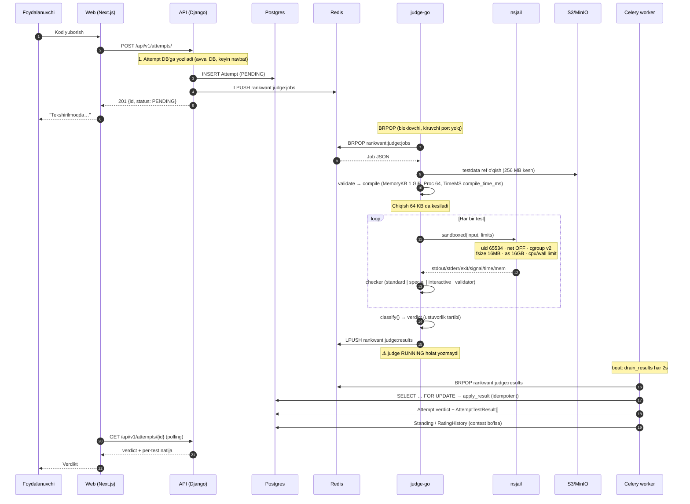

### 11.2 Verdict taksonomiyasi

| Guruh | Kodlar | Holat |
|---|---|---|
| Asosiy | `AC`, `WA`, `TLE`, `MLE`, `OLE`, `RE`, `CE`, `PE`, `PARTIAL`, `IDLENESS` | `protocol.go:184-209` |
| Tizim | `COMPILE_TIMEOUT`, `SECURITY_VIOLATION`, `IE`, `CHECKER_ERROR`, `WRONG_TEST` | `protocol.go`, `verdicts.py:8-51` |
| Signal/exit | `RE_SIGNAL`, `RE_EXIT` | API-only (`verdicts.py`) |
| **Legacy** | `RE` — **18 163 qator**, `RE_SIGNAL`/`RE_EXIT` ga bo'linishi kerak | `verdicts.py:16-18` |
| **O'lik** | Product Strategy: 4 ta kod "yozilmaydi" — aniqlanishi kerak | PS F05 |

**Klassifikatsiya tartibi:** `classify()` (`judge.go:361-400`) — **ustuvorlik tartibi hujjatlashtirilmagan** (PS F05 talabi).

### 11.3 Isolation / privilege / limitlar (o'lchangan)

| Element | As-Is | Target | ADR |
|---|---|---|---|
| Sandbox primitivi | nsjail (Apache-2.0), **tayyor** | O'zgarmaydi (out-of-scope: "o'z sandbox primitivi") | ADR-0004 ✅ |
| User | `65534:65534` | O'zgarmaydi | — |
| Namespace | nsjail default | **userns + seccomp aniq profil** | ADR 0028 |
| Tarmoq | `--iface_no_lo` ✅ | O'zgarmaydi | ✅ |
| `/proc` | `--disable_proc` / `hidepid=invisible` | O'zgarmaydi | ✅ |
| rlimit | fsize 16 MB · as 16 GB · cpu · nproc · wall+30 | `as` **qayta ko'riladi** (16 GB bitta sandbox uchun katta) | ADR 0028 |
| cgroup | v2: `pids.max`, `memory.max`, `swap.max=0` | O'zgarmaydi | ✅ |
| **Konteyner** | **`privileged: true` + `cgroup: host`** | **❌ olib tashlanadi**: systemd unit `Delegate=yes` + nsjail userns; `cap_drop: ALL`; faqat kerakli `CAP_SYS_ADMIN` (userns uchun) yoki userns'siz rejim | **ADR 0028** |
| seccomp | nsjail default (aniq emas) | **Aniq profil** (allowlist: read/write/exec/mmap/exit…) | **ADR 0028** |
| DB credential | yo'q ✅ | O'zgarmaydi | ✅ |
| **Host ajratish** | **❌ bir host** (preview) | **Alohida judge host ×N** | **ADR 0029** |

### 11.4 Queue semantikasi, retry, idempotentlik, failure

| Jihat | As-Is | Target |
|---|---|---|
| Navbat | Redis `LIST` (`LPUSH`/`BRPOP`) | **Saqlanadi** (Kafka/RabbitMQ — out-of-scope, trigger: > 200/s barqaror). **RECOMMENDATION:** `BRPOPLPUSH` → **processing list** (visibility timeout) — judge yiqilsa job **yo'qolmaydi** |
| Yetkazish | At-most-once (BRPOP job'ni **o'chiradi**) | **At-least-once** + idempotentlik kaliti (`attempt_id` + `testset_version`) |
| Retry | `reap_stuck` (60 s) bir marta qayta navbatga → keyin `DENIAL_OF_JUDGEMENT` ✅ | Saqlanadi + **DLQ** (`rankwant:judge:dead`) poison job uchun |
| Idempotentlik | `apply_result` `select_for_update` ✅ | Saqlanadi + `attempt_id` bo'yicha unique natija |
| Judge crash | `RUNNING` holat yozilmaydi → PENDING qoladi → `reap_stuck` | **Yaxshilanadi:** `RUNNING` + `started_at` + heartbeat; reap faqat heartbeat eskirganda |
| Failure handling | Verdict `IE` / `DENIAL_OF_JUDGEMENT` | Saqlanadi + **alert** (IE ko'payishi = tizim signali) |
| Observability | `/slo/` view (navbat uzunligi) | + metrika: navbat uzunligi, p50/p95, worker band, IE rate, DLQ hajmi |
| Navbat prioriteti | yo'q | **Yangi:** contest submit > practice submit > rejudge (alohida navbat yoki priority score) |

### 11.5 Judge scaling

```text
FACT: 1 host = ~8 worker to'yinadi (8w = 8.0/s, chiziqli emas)
FACT: contest NFR = 500 submit / 10 s = 50 submit/s
INFERENCE: kerak ≈ 6–8 host (50/s ÷ 8/s ≈ 6.25)

Richag 1 (arzon, katta ta'sir): KOMPILYATSIYA KESHI
   manba hash'i bo'yicha; rejudge va takroriy yechim kompilyatsiyani o'tkazib yuboradi
   FACT: total_ms ning ~830 ms i kompilyatsiya → kesh bilan katta yutuq
Richag 2 (qimmat): HOST qo'shish (avtomatik emas — contest oldidan QO'LDA)
   FACT: "autoscale spike'ga ulgurmaydi (contest boshlanishi 10 soniyalik hodisa)"
```

**RECOMMENDATION:** compile cache — **birinchi** ish (arzon, katta ta'sir); host pool — contest kalendari bilan **oldindan** rejalashtiriladi, autoscale'ga tayanmaydi.

### 11.6 Testdata modeli

| Element | As-Is | Target |
|---|---|---|
| Joy | S3/MinIO (`TestCase.input_ref`, `output_ref`) | O'zgarmaydi |
| Kirish | Judge **uzoq muddatli** S3 kaliti (`S3_KEY`/`S3_SECRET`) | **Qisqa muddatli credential** (STS yoki presigned) — API beradi |
| Ref | ADR-0010 — per-test refs (S3 pointer) | O'zgarmaydi |
| Etalon yechim | `ReferenceSolution` — **OneToOne per Problem** (ADR-0021) | **Qaror kerak** (D5): per-subtask |
| Validator | `Validator` modeli mavjud | Saqlanadi + checker validatsiya quvuri (13-bo'lim) |
| Kesh | 256 MB in-memory | Saqlanadi |
| **Chegara** | Judge **butun** bucket'ga kirish huquqi bor | **Per-problem prefiks** + faqat kerakli masala testdata'si |

---

## 12. AI Architecture

### 12.1 Umumiy model

```text
RankWant (L2 Application)
        │  policy-checked, DTO-only request
        ▼
┌──────────────────────────────────────────┐
│  AI Gateway (BC9 — alohida servis yoki   │
│  modul, L7)                              │
│  · caller authN/Z (service token)        │
│  · POLICY: practice | contest            │
│  · rate limit + kunlik byudjet           │
│  · context builder (whitelist)           │
│  · prompt registry (versiyalangan)       │
│  · kesh (semantik + aniq)                │
│  · audit (har so'rov)                    │
│  · cost attribution                      │
│  · eval hook                             │
└───────────────┬──────────────────────────┘
                │
        ┌───────▼────────┐
        │ Model Adapter  │  (interfeys)
        └───┬────────┬───┘
            │        │
   ┌────────▼──┐  ┌──▼─────────────────┐
   │ Lokal model│  │ Bulut model        │
   │ (vLLM/     │  │ (faqat explicit    │
   │  Ollama)   │  │  consent +         │
   │  default   │  │  zero-retention)   │
   └────────────┘  └────────────────────┘
```

### 12.2 AI Gateway mas'uliyatlari (aniq ro'yxat)

| Komponent | Mas'uliyat | Nega |
|---|---|---|
| **Gateway API** | Yagona kirish nuqtasi; service-to-service authN | AI'ni **bir** joydan nazorat qilish |
| **Policy enforcement** | Rejim aniqlash (practice/contest), ruxsat/rad | PS #9 — **server-side** |
| **Rate limit + byudjet** | Per-user kunlik so'rov va xarajat chegarasi | Cost control (PS AI metrika: CPF) |
| **Context Builder** | Faqat **whitelist** qilingan maydonlardan DTO yig'adi | Chegara: testdata **hech qachon** |
| **Prompt Registry** | Prompt versiyalangan, `PromptVersion` jadvalida | Reproducibility + eval |
| **Model Adapter** | Bir interfeys, ko'p model | Vendor lock-in (REPORT §3.1: 35% eng katta xavf) |
| **Kesh** | Aniq (hash) + semantik (embedding) | Cost + latency |
| **Audit** | Har so'rov/rad yoziladi (PS talab: `RatingHistory` naqshi) | Governance |
| **Eval hook** | Golden set'ga yozib boradi | PS §10.4 — eval harness **AI'dan oldin** |
| **Cost attribution** | Per-feedback, per-user, per-model | CPF metrikasi |

### 12.3 Qat'iy chegara (muzokara qilinmaydi)

```text
AI Gateway
  ✅ → Model Adapter → lokal/bulut model
  ✅ → Audit store (o'z jadvali)
  ✅ → Analytics (event)
  ✅ ← L2 Application (DTO: statement, user code, verdict, metadata)

  ❌ → Postgres (to'g'ridan-to'g'ri)        [DATABASE_URL berilmaydi — judge naqshi]
  ❌ → testdata bucket (yashirin test)      [integrity aktivi]
  ❌ → judge host (har qanday shaklda)      [ADR-0004]
  ❌ → Redis judge navbati                  [navbatga yozish = judge'ga ta'sir]
  ❌ → verdikt yo'li (AI natijasi verdict bo'lolmaydi)  [AP2]
```

**Majburlash:** `tools/check_ai_boundary.py` (yangi) — `ai/` papkasida `DATABASE_URL` ishlatilmasligi, `problems.models` import qilinmasligi, `judging` import qilinmasligi. **Naqsh:** `tools/check_security_boundary.py` allaqachon shunday ishlaydi (FACT).

### 12.4 Model routing (local-first / hybrid)

| Yo'nalish | Model | Sabab (Product Strategy §10.2) | Chegara |
|---|---|---|---|
| AI Feedback | **Lokal** | Yuqori hajm + foydalanuvchi kodi IP riski | Kod lokal qoladi |
| AI Mentor | **Hybrid** | Yuqori hajm lokal; bulut faqat explicit consent | Consent + zero-retention |
| Tarjima | **Hybrid/batch** | Kontent public → bulut maqbul | Inson spot-check **majburiy** |
| Anti-cheat | **Lokal** | Sezgir korpus | Flag + **inson ko'rigi** |
| Recommendation | **Lokal/klassik** | LLM shart emas | — |
| Problem/Test Gen | **Lokal** | Muallif kontenti + sandbox validatsiya | Editorial review **majburiy** |
| Teacher tools | **Lokal** | Bolalar ma'lumoti → yuqori maxfiylik | Teacher nazorati |
| Editorial | **Lokal** | Past risk | Editorial review |

**RECOMMENDATION:** REPORT'ning "high-volume → lokal, cloud faqat consent + zero-retention" naqshi **qabul qilinadi** — u ADR 0034 ga aylanadi.
**⚠️ UNKNOWN (o'lchovsiz, Phase 3 ni bloklaydi):** bitta mashina production yuk ostida 7B modelni ko'taradimi? (PS §10.2 OPEN QUESTION). **Bu o'lchovsiz P3 boshlanmaydi.**

### 12.5 AI Feedback Flow (to'liq)

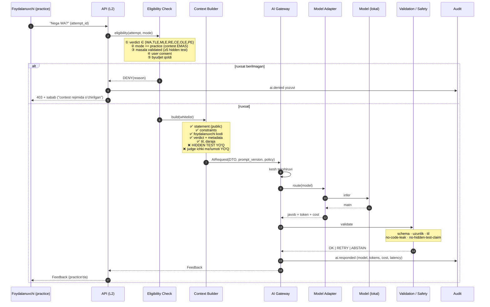

### 12.6 Practice vs Contest — server-side enforcement modeli

```text
Request (POST /api/v1/ai/feedback/)
        │
        ▼
① Identity       → user = request.user  (anonim → rad)
        │
        ▼
② Context resolve → attempt_id → Problem, Contest, created_at
        │
        ▼
③ MODE CHECK     → ContestMode.resolve(user, problem, now)
        │              ├─ attempt.contest_id is not None
        │              │   AND contest window ichida       → CONTEST
        │              ├─ foydalanuvchi aktiv contest'da
        │              │   (registration + window)          → CONTEST
        │              └─ aks holda                         → PRACTICE
        ▼
④ POLICY         → POLICY[mode] = {PRACTICE: ALLOW, CONTEST: DENY}
        │
        ▼
⑤ ALLOW / DENY   → DENY: 403 + code=AI_DISABLED_IN_CONTEST
        │                    + audit yozuvi (ai.denied)
        │              ALLOW: davom
        ▼
⑥ Gateway        → ikkinchi tekshiruv (defense in depth, bir xil policy)
```

**Muhim (PS #10):** bu **faqat** platforma ichidagi AI'ni to'sadi. Foydalanuvchi boshqa oynada o'z AI'ini ishlatishi **to'sib bo'lmaydi** — bu ochiq tan olinadi; anti-cheat **flag + inson ko'rigi** bilan boshqariladi (Phase 5).

**INFERENCE (arxitektura talabi):** policy **ikki joyda** tekshiriladi (API + Gateway) — chunki Gateway alohida servis bo'ladi va uni to'g'ridan-to'g'ri chaqirish yo'li qolmasligi kerak.

---

## 13. Instrumentation / Event Architecture

### 13.1 Muammo (FACT)

| Element | Holat |
|---|---|
| `AnalyticsEvent` modeli | **bor**: `name`, `user` (nullable), `session_key`, `path`, `locale`, `props` JSON, indeks `(name, -created_at)`; **IP saqlanmaydi** |
| Frontend tracking | **bor**: `src/lib/analytics.ts` — batch 25, flush 1500 ms, `keepalive`, A/B variant |
| Call site | **9 ta** — asosan auth funnel (`AuthForm`, `OnboardingForm`, `PrefsSync`) |
| Real/seed ajratish | **yo'q** |
| Funnel | **yo'q** (signup → first submit → first AC o'lchanmaydi) |
| Server-side event | **yo'q** (submit, verdict, AC server tomonda yozilmaydi) |

**INFERENCE:** instrumentatsiya **boshlangan, lekin auth funnel'dan nariga o'tmagan**. Eng muhim event'lar (submit, verdict, first AC) **yo'q**.

### 13.2 Kanonik event envelope (target)

```json
{
  "event_id": "uuid-v4",
  "name": "attempt.judged",
  "schema_version": 1,
  "occurred_at": "2026-09-29T12:34:56.789Z",
  "ingested_at": "2026-09-29T12:34:57.001Z",

  "origin": "real",
  "actor": { "user_id": 12345, "account_type": "student" },
  "session": { "session_key": "…" },

  "context": {
    "locale": "uz",
    "path": "/problems/a-plus-b",
    "app_version": "web@1.2.3",
    "client": "web"
  },

  "subject": {
    "type": "attempt",
    "id": 987654,
    "problem_id": 437,
    "contest_id": null,
    "classroom_id": null
  },

  "props": {
    "verdict": "WA",
    "language": "cpp",
    "test_index": 3,
    "time_ms": 41,
    "memory_kb": 1840,
    "attempt_number": 4
  }
}
```

**Yangi maydonlar va sabab:**

| Maydon | Nega | Migratsiya |
|---|---|---|
| `event_id` | Idempotentlik (takroriy yuborish) | Yangi ustun (unique) |
| `schema_version` | Sxema evolyutsiyasi | Yangi ustun, eski = 0 |
| `origin` | **Seed/real ajratish** (CONFLICT-2, G4) | Yangi ustun |
| `subject_type` / `subject_id` | Obyekt bo'yicha bog'lash | Yangi ustunlar |
| `occurred_at` (ajratilgan) | Client vaqti ≠ ingest vaqti | Yangi ustun |

### 13.3 Kanonik event katalogi

| Event | Trigger (server-side) | `subject` | Muhim `props` | Funnel qadami |
|---|---|---|---|---|
| `user.registered` | Signup muvaffaqiyatli | user | `method` (email/telegram/google/github), `locale` | **① Activation** |
| `user.logged_in` | Login | user | `method`, `days_since_register` | Retention |
| `problem.viewed` | Masala sahifasi | problem | `difficulty`, `topic_ids`, `source` (list/search/recommend) | **② Discovery** |
| `problem.started` | "Yechishni boshlash" | problem | `attempt_number` | **③ Intent** |
| `attempt.created` | Submit qabul | attempt, problem | `language`, `code_length`, `has_editorial_viewed` | **④ First submit** |
| `attempt.judged` | Verdict yozildi | attempt, problem | `verdict`, `time_ms`, `memory_kb`, `failed_test_index` | **⑤ Feedback** |
| `user.first_ac` | Birinchi AC (per problem) | problem | `attempts_to_ac`, `minutes_since_start`, `difficulty` | **⑥ North Star** |
| `attempt.retried` | Oldingi verdict'dan keyin qayta submit | attempt, problem | `previous_verdict`, `seconds_since_previous` | Retry loop |
| `ai.feedback.requested` | AI so'rovi | attempt | `mode` (practice), `verdict` | AI funnel |
| `ai.feedback.responded` | Javob berildi | attempt | `model`, `tokens`, `cost_usd`, `latency_ms`, `prompt_version` | AI cost |
| `ai.feedback.rated` | Foydalanuvchi bahosi | attempt | `useful` (bool), `reason` | **FAR metrikasi** |
| `ai.denied` | Policy rad etdi | attempt | `reason`, `mode` | Integrity |
| `contest.joined` | Ro'yxatdan o'tish | contest | `format`, `registered_at` | **Contest funnel** |
| `contest.participated` | ≥1 submit contest'da | contest | `problems_solved`, `final_rank` | Contest funnel |
| `classroom.assignment.created` | Topshiriq | classroom, assignment | `problem_count`, `due_in_days` | **B2B funnel** |
| `classroom.student.submitted` | O'quvchi submit | classroom, attempt | `assignment_id`, `on_time` | B2B funnel |

**FACT:** yuqoridagilardan faqat `user.registered` / `user.logged_in` ga **yaqin** event'lar bor (auth funnel, 9 call site). Qolganlari **yangi**.

### 13.4 Seed / real ajratish mexanizmi (uch qatlam)

```text
QATLAM 1 — MA'LUMOT (yagona haqiqat manbasi)
  User.origin ∈ {real, demo, imported, staff}     ← ADR 0030
  Attempt.origin  (denormalizatsiya — o'qish tezligi)
  Backfill: neytron_ prefiksi + email yo'q + seed command audit
  ⚠️ Prefiks evristikasi vaqtinchalik — backfill'dan keyin O'CHIRILADI

QATLAM 2 — EVENT
  Har event envelope'da origin maydoni
  Ingest: origin = actor.origin (yoki "system" agar actor yo'q)
  Demo event'lar SAQLANADI (test uchun), lekin default SEGMENT ajratilgan

QATLAM 3 — SO'ROV (metrika)
  Har metrika SQL'i origin = 'real' filtri bilan
  MAJBURLASH: tools/check_metrics.py — metrika so'rovlarida filtr yo'qligini CI'da ushlaydi
  Dashboard: default ko'rinish "real"; "demo" alohida toggle
```

**Nega uch qatlam:** bitta joyda (faqat DB) ajratish yetarli emas — event'lar va metrikalar mustaqil ifloslanadi. Uch qatlam **mustaqil tekshiriladi** (AP11).

### 13.5 Pipeline

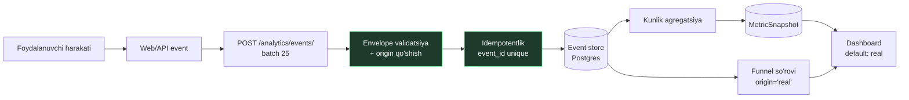

**Muhim qoida:** analytics yozuv **domen yozuvini bloklamaydi** (fire-and-forget). `attempt.judged` kabi **muhim** event'lar server tomonda **transaksiyadan keyin** (`transaction.on_commit`) yoziladi — naqsh allaqachon repo'da bor (`profiles/views.py:278`, `ratings/services.py:123`).

---

## 14. Security Architecture

### 14.1 Trust boundaries (ishonch zonalari)

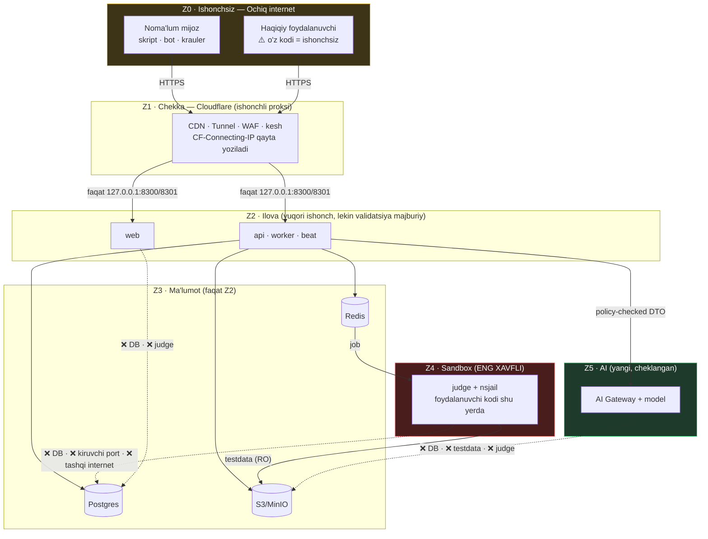

### 14.2 Model bo'yicha holat va target

| Soha | As-Is (dalil) | Target | ADR |
|---|---|---|---|
| **Authentication** | Session (`httpOnly`+`Secure`+`SameSite=Lax`, 30 kun, Redis backend) + PAT (`rw_` + SHA-256, scope, ≤1 yil, ≤10 faol) + OIDC (Google/GitHub/Telegram) | O'zgarmaydi ✅ | ADR-0008 ✅ |
| **Authorization** | 3 staff guruh (`staff-support/content/ops`), permission klasslar (`HasScope`, `CanSubmit`, `CanManageContest`, `StaffOps`, `StaffContent`) | Saqlanadi + **object-level izchillashtirish** | ADR-0025 ✅ + yangi |
| **RBAC** | Guruh + M2M object ownership (muallif/organizer) | Saqlanadi; `Organization` roli qo'shiladi (BC11/BC8) | — |
| **Service-to-service auth** | **YO'Q** — hamma servis bitta network'da | **Yangi:** AI Gateway ↔ API uchun service token; judge uchun **kerak emas** (Redis navbat = bir tomonlama) | ADR 0033 |
| **Secrets** | ⚠️ Dev-default'lar compose'da (`dev`, `devdevdev` ×4, `DJANGO_SECRET_KEY` fallback); haqiqiy sirlar `.env.public`/`.env.handoff` (untracked) | Production'da **default yo'q** (fail-fast); sir manager yoki Docker secret; gitleaks CI'da | ADR 0044 |
| **Judge isolation** | uid 65534 · net OFF · rlimit · cgroup v2 ✅ / **`privileged:true` ❌** | `privileged` olib tashlanadi + seccomp + userns | **ADR 0028** |
| **Sandbox** | nsjail (Apache-2.0, tayyor) ✅ | + aniq seccomp profil | ADR 0028 |
| **API abuse protection** | 12 throttle scope ✅; `TrustedClientIdent` (XFF soxtalashtirishga qarshi) ✅ | Identity-aware + NAT-aware | ADR 0032 |
| **Rate limiting** | IP-based anon; **`InternalRenderRate`** (SSR alohida) ✅ | + `org:<id>` bucket; + read/write ajratish | ADR 0032 |
| **Audit logging** | `RatingHistory` ✅, `QvantTransaction` ✅; umumiy audit log **qisman** (PS F63) | `AuditLog` (staff harakat, AI rad/so'rov, entitlement o'zgarishi) | ADR 0045 |
| **AI prompt injection** | **YO'Q** (AI yo'q) | Untrusted input belgilanadi (foydalanuvchi kodi + statement); model **tool chaqira olmaydi**; chiqish validatsiyasi | ADR 0036 |
| **Tool abuse** | **YO'Q** | AI Gateway'da **tool ruxsat ro'yxati**; feedback modelida **tool yo'q** | ADR 0036 |
| **Data leakage** | Testdata bitta bucket + uzoq muddatli kalit ⚠️ | Per-problem prefiks + qisqa muddatli credential | ADR 0038 |
| **Contest abuse** | Deterministik judge ✅; anti-cheat **YO'Q** | Flag + **inson ko'rigi majburiy** | ADR 0035 |

### 14.3 Threat boundaries (asosiy tahdidlar)

| # | Tahdid | Vektor | Hozirgi holat | Target himoya |
|---|---|---|---|---|
| T1 | **Sandbox escape → host root** | Foydalanuvchi kodi nsjail'ni buzadi | ⚠️ `privileged:true` → escape = **host root**; bundan tashqari **bir hostda DB va testdata** | ADR 0028 (privilege) + ADR 0029 (host ajratish) |
| T2 | **Testdata sizib chiqishi** | Judge buziladi → butun bucket | ⚠️ bitta uzoq muddatli kalit | ADR 0038 |
| T3 | **Verdikt soxtalashtirish** | Navbatga soxta natija `LPUSH` | Redis bitta instans, auth yo'q (ichki tarmoq) | Tarmoq izolyatsiya + natija imzosi (trigger) |
| T4 | **Rate-limit chetlab o'tish** | `X-Forwarded-For` soxtalashtirish | ✅ **Yopilgan** (`TrustedClientIdent`) | Saqlanadi |
| T5 | **Sir sizib chiqishi** | Repo/CI/log | ⚠️ dev-default'lar; gitleaks **o'chirilgan** | ADR 0044 + `security.yml` yoqish |
| T6 | **Prompt injection** | Foydalanuvchi kodi/statement ichida ko'rsatma | — (AI yo'q) | ADR 0036 |
| T7 | **AI orqali ma'lumot sizib chiqishi** | AI'ga testdata yoki boshqa user kodi ketadi | — | ADR 0036 (context whitelist) |
| T8 | **Contest integrity buzilishi** | Contest ichida AI yordami | — | ADR 0035 (server-side deny) + ochiq tan olish (PS #10) |
| T9 | **Privilege escalation (staff)** | Staff guruh chegarasidan chiqish | Object-level izchil emas (G13) | ADR 0045 + permission audit |
| T10 | **Backup orqali sizib chiqish** | `pg_dump` himoyasiz | ⚠️ off-site R2 **default OFF**; shifrlash e'lon qilinmagan | ADR 0043 |
| T11 | **DDoS / crawler** | Ommaviy skanerlash | ✅ `InternalRenderRate` + mehmon kesh (o'lchangan hodisadan keyin) | Saqlanadi + CF WAF (repo'da **qoida yo'q**) |
| T12 | **Qvant suiiste'moli** | Balansni to'g'ridan-to'g'ri yozish | ✅ **Yopilgan** (ledger + `verify_balance`) | Saqlanadi |

### 14.4 Security qarorlari

| Qaror | Qiymat |
|---|---|
| `security.yml` | **Qayta yoqiladi** (gitleaks, pip-audit, npm audit, compose tekshiruvi) — F65 P1 |
| `privileged: true` | **Olib tashlanadi** — muqobillar ADR 0028 da |
| Secrets | Dev-default'lar **faqat** `docker-compose.yml` (dev) da qoladi; `docker-compose.public.yml` **majburiy** qiymat talab qiladi (fail-fast) |
| Tashqi audit | ADR-0004: "ommaviy launch oldidan tashqi xavfsizlik auditi **majburiy**" — Phase 1 done condition |
| Cloudflare WAF/rate limit | Repo'da **qoida yo'q** → ADR (CF darajasidagi rate limit kod darajasidan **oldin** ishlaydi) |

---

## 15. Production Infrastructure

### 15.1 Current → Target topologiya

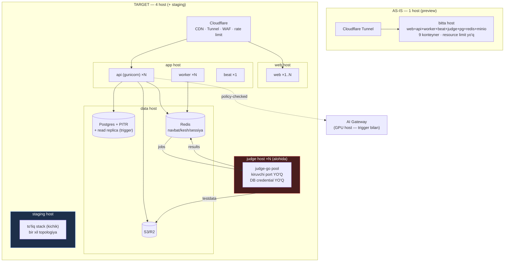

### 15.2 Host rollari (repo daliliga asoslangan)

`compose/four-host/README.md` **allaqachon** maqsad topologiyani belgilagan: `data` · `app` · `web` · `judge×N`, "K8s yo'q", "har host o'z `docker compose` ni yuritadi". **Bu hujjat o'zgartirilmaydi** — u target arxitekturaning asosi sifatida **qabul qilinadi**.

| Host | Servislar | Tarmoq | Qo'shimcha target |
|---|---|---|---|
| **data** | postgres, redis, minio | ichki; app/judge ulanadi | **PITR** (WAL → R2), kunlik backup off-site, `pg_stat_statements` ✅ |
| **app** | migrate, api, worker, beat | → data; web → api:8000 | `GUNICORN_WORKERS=CPU-1` ✅, **resource limitlar**, navbat ajratish |
| **web** | web | → app `API_BASE_INTERNAL`; CF → 8300 | `docker-compose.replicas.yml` (web×2 + Caddy `origin-lb`) ✅ mavjud |
| **judge ×N** | judge | → data Redis/S3; **kiruvchi port yo'q**, `DATABASE_URL` yo'q | **privileged olib tashlash**, seccomp, pool, compile cache, **host soni contest kalendari bilan** |
| **staging** ⭐yangi | to'liq stack (kichik) | alohida | **GAP** → ADR 0040 |

### 15.3 Muhitlar

| Muhit | As-Is | Target |
|---|---|---|
| **dev** | `docker-compose.ci.yml` (bir martalik profil: smoke/latency/bakeoff) | O'zgarmaydi |
| **staging** | **YO'Q** ⚠️ (hujjatda bor — CONFLICT-3) | **Yangi host**, production bilan bir xil topologiya, kichik; CI → staging → prod |
| **prod** | 1 host, "ommaviy preview" | **4 host**, `rankwant.uz` = production |

### 15.4 Deploy / rollback / backup / DR

| Jihat | As-Is | Target |
|---|---|---|
| **Deploy** | `deploy.yml` — qo'lda (`workflow_dispatch`), `confirm == 'deploy'` sharti, **contest oynasi tekshiriladi** ✅, self-hosted runner | Saqlanadi + **staging bosqichi** qo'shiladi |
| **Rollback** | `git revert` + `up -d --build --wait` + `check_deploy.sh` ✅. **Migratsiya rollback qilinmaydi** — sxema oldinga: `add → backfill → switch → drop` (alohida deploylar) ✅ | Saqlanadi — bu **to'g'ri naqsh** |
| **Backup** | Oylik `pg_dump` + MinIO tar; host cron (`0 4 1 * *`), keep 30 (deploy 7 / monthly 95); off-site R2 **default OFF**; **har safar avtomatik restore testi** ✅ | **Kunlik**; off-site **ON** (majburiy); shifrlash; **PITR** |
| **PITR** | **YO'Q** — WAL archiving yo'q | WAL → R2; RPO ≤ 24 soat |
| **RPO / RTO** | RPO ≤ **30 kun**; RTO DB ~9 s, servis 1–12 h | RPO ≤ **24 soat**; RTO raqamlashtirilgan + **mashq qilingan** |
| **DR** | Failover **yo'q**; 1 on-call | Failover rejasi + eskalatsiya zanjiri (F76) |
| **Secrets** | `.env.public` (untracked) ✅; compose'da dev-default'lar ⚠️ | Sir manager / Docker secret; production'da default yo'q |
| **Resource limit** | **YO'Q** | Har servisga `deploy.resources` / `mem_limit` / `cpus` |

**FACT:** `tools/backup.sh` har safar **restore testi** qiladi (`restore_test` DB) — bu **kuchli naqsh**, saqlanadi va **kengaytiriladi** (PITR restore testi).

---

## 16. Scalability Strategy

### 16.1 Bottleneck'lar (o'lchangan)

| # | Bottleneck | O'lchangan qiymat | Kerak | Zaxira |
|---|---|---|---|---|
| **B1** | **Judge throughput** | 1w **2.4/s** · 2w 3.3/s · 4w 5.4/s · **8w 8.0/s** (chiziqli emas) | Contest NFR **50/s** | **6.3×** yetmaydi |
| **B2** | **Kompilyatsiya (CPU-bound)** | `total_ms` ning ~**830 ms** i kompilyatsiya | — | Eng katta richag (compile cache) |
| **B3** | **Standings serve** | Origin ~**130 req/s** | **7 300 req/s** (110 000 tomoshabin / 15 s) | **56×** yetmaydi → CDN majburiy |
| **B4** | **API read** | **57 req/s** @20 VU; `/problems/` p95 **23 ms**; standings p95 **38 ms**; 0% xato | Contest spike | Bu **yaxshi** — bottleneck emas |
| **B5** | **NAT throttle** | ⚠️ CONFLICT-1 (60/min yoki 1500/hour) | Bitta IP'da 20+ user | O'lchov kerak |
| **B6** | **Redis** | 3 rol bir instansda (session + broker + judge navbat) — `docs/06:147` **assumption** | — | Trigger bilan ajratish |
| **B7** | **Celery worker** | `--concurrency 2`; `drain_results` har **2 s** | Verdict kechikishi | 2 s polling = p50 ga **+1 s** qo'shadi (INFERENCE) |
| **B8** | **DB** | 384 569 attempt; `Attempt` 5 indeks | — | Hozir bottleneck emas; trigger: >10M qator |
| **B9** | **AI request** | — (yo'q) | — | GPU capacity **UNKNOWN** (o'lchovsiz) |
| **B10** | **Notification** | Telegram bot + email 4-provayder zanjiri | — | Past hajm |

### 16.2 Scaling strategiyasi (faqat kerak bo'lganlari)

| Variant | Qo'llaniladimi | Qayerda | Trigger |
|---|---|---|---|
| **Vertical** | ✅ **Ha** | app host CPU (gunicorn workers = CPU-1 ✅ allaqachon) | — |
| **Horizontal** | ✅ **Ha** | **judge host** (asosiy), web/api (replica overlay ✅ mavjud) | Contest kalendari (oldindan, autoscale emas) |
| **Caching** | ✅ **Ha** | Standings **CDN** (B3), masala/statement kesh, compile cache (B2) | B3 = **majburiy** |
| **Queue** | ✅ **Ha** | Navbat ajratish: `default` / `judge_results` (prioritetli) / `analytics` | Verdict kechikishi > 5 s |
| **Read replica** | ⏳ **Trigger bilan** | Postgres read replica | Faol user > 50k YOKI o'qish p95 > 200 ms |
| **Partitioning** | ⏳ **Trigger bilan** | `Attempt`, `Event` | > 10M qator YOKI so'rov p95 > 200 ms |
| **Worker scaling** | ✅ **Ha** | Celery `--concurrency` + worker replikasi | Navbat uzunligi > 100 (doimiy) |
| **Rate limiting** | ✅ **Ha** | Identity-aware (17-bo'lim) | CONFLICT-1 o'lchovi |

### 16.3 Contest spike rejasi (eng kritik stsenariy)

```text
T-7 kun : contest e'lon qilinadi → host soni hisoblanadi (50/s ÷ 8/s ≈ 7 host)
T-1 kun : judge hostlar oldindan ko'paytiriladi (autoscale spike'ga ulgurmaydi — FACT)
          standings CDN qoidasi tekshiriladi
T-0     : contest boshlanadi
          · standings → CDN (origin himoyalanadi)
          · submit → prioritetli navbat
          · judge navbati uzunligi /slo/ da kuzatiladi
T+0     : contest yakuni → `finalize_due` (60 s) → reyting + sertifikat
T+1 kun : host soni kamaytiriladi
```

**FACT:** repo'da **contest oldidan host ko'paytirish** qoidasi allaqachon hujjatlashtirilgan (`compose/four-host/README.md`, `docs/10-operations:77-78`). Bu **qabul qilinadi** — arxitektura o'zgartirmaydi.

---

## 17. B2B Architecture

### 17.1 Workflow → technical model

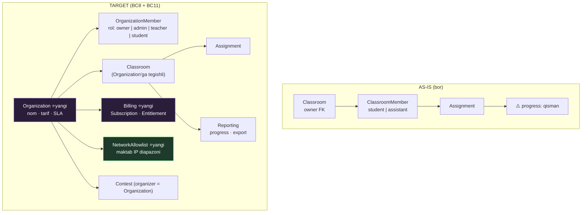

### 17.2 Model (target)

| Entity | Egasi | Maydonlar (asosiy) | Izoh |
|---|---|---|---|
| `Organization` ⭐ | BC11/BC8 | `name`, `slug`, `type` (school/network/ministry/partner), `created_by` | **Bugun yo'q** — B2B ning ildizi |
| `OrganizationMember` ⭐ | BC8 | `org`, `user`, `role` (owner/admin/teacher/student), `joined_at` | Classroom member'dan **ajratilgan** |
| `Classroom` | BC8 | + **`organization` FK** (nullable — orqaga mos) | Mavjud `owner` FK saqlanadi |
| `Assignment` | BC8 | + `due_at`, `problem_ids`, `grading` | Mavjud |
| `NetworkAllowlist` ⭐ | BC12 | `org`, `cidr`, `expires_at`, `created_by`, `reason` | NAT muammosi uchun (17.3) |
| `Subscription` ⭐ | BC11 | `org`, `plan`, `status`, `period_start/end` | 18-bo'lim |
| `Entitlement` ⭐ | BC11 | `org`, `feature`, `limit`, `valid_until` | **Kirish nazorati shu yerdan** |

**Muhim:** `Classroom.organization` **nullable** — mavjud sinflar (`owner` bilan) ishlashda davom etadi. Migratsiya: `add nullable → backfill (owner asosida shaxsiy Organization) → switch → (drop emas)`.

### 17.3 NAT throttling — account-aware arxitektura

**Muammo (FACT):** throttle kaliti — IP. Maktab kompyuter sinfi bitta tashqi IP ortida. Hozirgi konfiguratsiya `1500/hour`; hujjat/o'lchov `60/min` deydi (CONFLICT-1).

**Target: identity-first, IP-fallback, org-boost**

```text
Request
  │
  ▼
① IDENTITY RESOLVE
   ├─ authenticated user      → bucket = "user:<id>"
   ├─ anonymous + session     → bucket = "ip:<ip>:session"
   └─ anonymous, sessiyasiz   → bucket = "ip:<ip>"
  │
  ▼
② ORG RESOLVE (faqat authenticated)
   ├─ user ∈ OrganizationMember → bucket += "org:<id>"
   └─ ip ∈ NetworkAllowlist(org) → bucket += "org:<id>"
  │
  ▼
③ SCOPE RESOLVE
   ├─ SAFE_METHODS (GET/HEAD)  → keng chegara (o'qish)
   └─ yozish (POST/PUT/PATCH)  → qat'iy chegara (submit 6/min va h.k.)
  │
  ▼
④ LIMIT SELECT (eng qat'iy mos keladigan bucket)
   anon/ip            : 1500/hour      (saqlanadi)
   user               : 300/min        (saqlanadi)
   org:<id>           : org kvotasi (Organization'ga bog'langan, sozlanadi)
   submit             : 6/min          (saqlanadi — suiiste'mol himoyasi)
  │
  ▼
⑤ ALLOW / DENY (429 + Retry-After)
```

**Nima uchun bu abuse'ni zaiflashtirmaydi:**

| Himoya | Nima uchun ishlaydi |
|---|---|
| Yozish **har doim** user-scoped | Maktab 6/min ni **har o'quvchi** uchun oladi; jami ko'paymaydi |
| `NetworkAllowlist` — **muddatli** + audit | Vaqtinchalik, kim qo'shgani yoziladi |
| `org:<id>` kvotasi — **cheklangan** | Cheksiz emas; tarifga bog'langan (BC11) |
| `TrustedClientIdent` saqlanadi | `X-Forwarded-For` soxtalashtirish **yopiq** |
| `InternalRenderRate` saqlanadi | SSR alohida kalit — sayt krauler bosimida ham ochiq qoladi |

**⚠️ Ochiq savol (CONFLICT-1):** joriy `1500/hour` maktab stsenariysi uchun **yetarlimi** — o'lchanmagan. `org:` bucket **faqat** o'lchovdan keyin kiritiladi.

### 17.4 B2B uchun qo'shimcha arxitektura talablari

| Talab | Sabab | ADR |
|---|---|---|
| **Bolalar ma'lumoti maxfiyligi** | R4 persona (o'quvchi) — maktab konteksti | ADR 0045 (audit) |
| **Ommaviy onboarding** (CSV/ro'yxat import) | 30 o'quvchi birma-bir qo'shilmasin (F49) | — |
| **Teacher analytics** | Kim qayerda qoqilgan (F50) — event'larga tayanadi | 13-bo'lim |
| **SLA + uptime** | Shartnoma talabi | 20-bo'lim NFR |
| **Multi-tenant izolyatsiya** | Bitta maktab boshqasining ma'lumotini ko'rmasin | **Object-level authorization izchillashtirish majburiy** (G13) |

**INFERENCE:** B2B ni **ochishdan oldin** object-level authorization (G13) yopilishi **majburiy** — multi-tenant'da bu xavfsizlik emas, **mahsulot buzilishi**.

---

## 18. Billing Boundary

### 18.1 Asosiy qoida

```text
        ┌──────────────────┐        ┌──────────────────────┐
        │  Qvant (BC5)     │   ≠    │  Billing (BC11)      │
        │  Engagement      │        │  Pul                 │
        │  Yopiq halqa     │        │  Ochiq halqa         │
        │  Ledger-only     │        │  Provider-backed     │
        │  Real qiymat YO'Q│        │  Haqiqiy pul         │
        │  ADR-0002        │        │  ADR 0041            │
        └──────────────────┘        └──────────────────────┘
             ❌ hech qanday kod yo'li ikkalasini bog'lamaydi
```

**FACT:** ADR-0002 Qvant'ni **yopiq halqa** deb belgilagan; Product Strategy: "Qvant real-money value — qaytarish trigger: yuridik ruxsat (ehtimol hech qachon)". **RECOMMENDATION:** bu chegara **kod bilan** majburlanadi: `billing/` `qvant` ni import qilolmaydi, `qvant/` `billing` ni import qilolmaydi (`check_architecture.py`).

### 18.2 Target bog'lanishlar

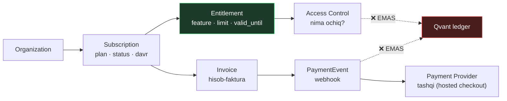

### 18.3 Boundary qarorlari

| Qaror | Qiymat | Sabab |
|---|---|---|
| **Joy** | `billing` — **alohida Django app** (BC11) | Chegara ko'rinadigan bo'lsin |
| **Schema** | Alohida jadvallar; `qvant` bilan **FK yo'q** | Qvant engagement, billing pul |
| **Secrets** | Provider kalitlari **alohida** (`BILLING_*`) | PCI/scope ajratish |
| **Karta ma'lumoti** | **Saqlanmaydi** — provider-hosted checkout | PCI DSS scope minimizatsiya |
| **Idempotency** | `PaymentEvent` — provider event id **unique** | Takroriy webhook |
| **Entitlement** | **Kirish nazorati faqat `Entitlement` orqali**; `Subscription` dan hisoblanadi | Tez o'qish + tarix |
| **Audit** | Har entitlement o'zgarishi `AuditLog` ga | Shartnoma/legal |
| **Trigger** | Billing **Phase 4** (Product Strategy) — lekin **chegara hozir** belgilanadi | PS §4.6 F48 BLOK: pricing ADR |
| **Blok** | Pricing ADR **yo'q** → billing **boshlanmaydi** | PS: F48 P1, "narxlash ADR (BLOK)" |

**RECOMMENDATION:** hozir **kod yozilmaydi** — faqat **ADR 0041** (chegara) yoziladi, shunda keyin arxitektura qayta ko'rilmaydi.

---

## 19. Observability

### 19.1 As-Is (FACT)

| Element | Holat |
|---|---|
| Health | `GET /api/v1/health/` — DB/Redis o'lsa **503** ✅ |
| SLO view | `GET /api/v1/slo/` — navbat uzunligi + bog'liqliklar ✅; `tools/check_slo.py` |
| Sentry | **Ataylab yo'q** (2026-09-19 qaror, `check_decisions.py:1392-1418` bilan majburlangan) |
| Metrics store | **yo'q** (Prometheus/Grafana/Loki/OTel yo'q) |
| Logging | Django standart console; strukturali/JSON **yo'q**; konteyner log json-file 10m×3 |
| Alerting | Jadval **faqat hujjatda**; `tools/monitor.ps1` + `.handoff/monitor.log` |
| Trace | **yo'q** |
| Deploy verification | `tools/check_deploy.sh` (GIT_SHA yorlig'i) ✅ |

### 19.2 Target (uch qadam, trigger bilan)

| Qadam | Nima | Trigger |
|---|---|---|
| **O1 — Signal** (Phase 0–1) | `/slo/` **kengaytiriladi**: judge navbat uzunligi, worker band, p50/p95, IE rate, DLQ hajmi, Redis xotira; **strukturali log** (JSON) | Darhol — arzon |
| **O2 — Alert** (Phase 1) | Alert kanali (Telegram bot **allaqachon bor** — `notifications/tasks.py:35`): judge p95 > 15 s · 5xx spike · error budget burn · navbat > N · IE rate o'sishi · testsiz yangi masala | 4-host topologiya bilan |
| **O3 — Store** (Phase 1–2) | Vaqt qatori saqlash (Prometheus/VictoriaMetrics **yoki** Postgres-based), dashboard | O2 dan keyin, **ADR 0039** qaroridan keyin |
| **O4 — Trace** (Phase 2+) | OpenTelemetry: submit → navbat → judge → verdict zanjiri | Multi-host + incident tahlili |

### 19.3 CONFLICT-4 hal qilish yo'li

**Muammo:** Product Strategy "Sentry quriladi" (F70, P1); repo "Sentry ataylab yo'q" (CI bilan majburlangan).

**RECOMMENDATION (ADR 0039):** **ehtiyoj** va **vosita** ajratilsin:

| Ehtiyoj | Vosita variantlari |
|---|---|
| Xatoni erta aniqlash | ① Sentry (yoki GlitchTip — self-hosted, ochiq kod) ② strukturali log + alert ③ mavjud `/slo/` + Telegram |
| Judge latency SLO ko'rinishi | `/slo/` kengaytmasi (allaqachon bor) |
| Trace | OTel (Phase 2+) |

**Qaror Product Owner'ga:** 2026-09-19 qarori **qayta ko'riladimi**? Agar yo'q bo'lsa — Product Strategy F70 **qayta yozilishi** kerak (bu hujjat Product Strategy'ni **o'zgartirmaydi** — faqat ziddiyatni ko'rsatadi).

---

## 20. NFR — Non-Functional Requirements

### 20.1 Performance

| Metrika | As-Is (o'lchangan) | Target | Holat |
|---|---|---|---|
| API read p95 | `/problems/` **23 ms** · standings **38 ms** | < 1000 ms / < 300 ms | ✅ **bajarilgan** |
| API throughput | **57 req/s** @20 VU, 0% xato | Contest spike | ✅ yaxshi |
| Judge p50 | **848 ms** (1w) … **984 ms** (8w) | < 5 s | ✅ |
| Judge p95 | **857 ms** (1w) … **1360 ms** (8w) | < 15 s | ✅ |
| **Judge SLO passing raqami** | **yozilmagan** ⚠️ | Gate skript real yuk ostida ishga tushadi, raqam yoziladi | ❌ **GAP** (F55) |
| Verdict ko'rinish kechikishi | + `drain_results` **2 s** polling (INFERENCE) | < 3 s p95 | ⚠️ o'lchanmagan |
| AI feedback latency | — | p95 raqamlanadi (eval'da) | ❌ AI yo'q |

### 20.2 Reliability

| Metrika | As-Is | Target |
|---|---|---|
| Availability SLO | **99.5%** ≈ 3 h 39 m budget (hujjatda) | Saqlanadi + **o'lchanadi** |
| Error rate | 0% (yuklama sinovida) | < 1% production |
| Recovery | Rollback ✅; migratsiya rollback **yo'q** (ataylab) | Saqlanadi |
| Judge crash recovery | `reap_stuck` 60 s, bir marta retry ✅ | + heartbeat + DLQ |
| Failover | **yo'q** ⚠️ | Reja + mashq |

### 20.3 Scalability

| Metrika | As-Is | Target |
|---|---|---|
| Concurrent users | **UNKNOWN** (0 real user) | O'lchanadi (Phase 2) |
| Concurrent submissions | 1w 2.4/s … 8w 8.0/s | **50/s** (contest) |
| Contest spike | **bajarilmaydi** (1 host) | 6–8 judge host |
| Standings serve | ~130 req/s origin | **7 300 req/s** CDN bilan |
| Classroom NAT | ⚠️ CONFLICT-1 | 20+ user/IP **429 olmaydi** |

### 20.4 Security

| Metrika | As-Is | Target |
|---|---|---|
| Judge isolation | uid 65534 · net OFF · cgroup v2 ✅ / `privileged:true` ❌ | `privileged` olib tashlanadi + seccomp + **alohida host** |
| Authentication | Session + PAT + OIDC ✅ | Saqlanadi |
| Audit | Ledger ✅ · reyting ✅ · umumiy audit **qisman** | `AuditLog` to'liq |
| Secrets | dev-default'lar ⚠️ | Repoda 0 sir, CI gate |
| Boundary gates | `check_security_boundary.py` ✅ | + AI boundary + architecture + metrics gate |

### 20.5 Data

| Metrika | As-Is | Target |
|---|---|---|
| Backup | Oylik, off-site **OFF** ⚠️ | **Kunlik**, off-site **ON**, shifrlangan |
| **RPO** | ≤ **30 kun** ❌ | ≤ **24 soat** |
| **RTO** | DB ~9 s; servis 1–12 h | Raqamlashtirilgan + **mashq qilingan** |
| PITR | **yo'q** ❌ | **bor** (WAL → R2) |
| Restore testi | ✅ **har backup'da avtomatik** | Saqlanadi + PITR restore testi |
| Data origin | **yo'q** ❌ | `origin` uch qatlamda |

### 20.6 Observability

| Metrika | As-Is | Target |
|---|---|---|
| Logs | Django console | Strukturali JSON |
| Metrics | `/slo/` view | Store + dashboard |
| Tracing | yo'q | OTel (Phase 2+) |
| Alerting | hujjatda | Kanali ishlaydi (Telegram mavjud) |
| Error tracking | **ataylab yo'q** | ADR 0039 qarori |

---

## 21. ADR Inventory (taklif — **fayllar hali yozilmagan**)

Mavjud ADR-0001…0027 **o'zgartirilmaydi**. Quyidagilar **yangi** takliflar — raqamlari `ADR NNNN` shaklida yozilgan, chunki **fayllar hali yozilmagan** (prompt talabi: "Hali ADR fayllarini yozmang").

| ADR | Mavzu | Context | Decision (taklif) | Alternatives | Trade-offs | Consequences |
|---|---|---|---|---|---|---|
| **ADR 0028** | **Judge privilege modeli** | `privileged:true` + `cgroup:host` — ADR-0004 `privileged` haqida jim; nsjail escape → host root | Judge konteyneri `privileged` **bo'lmaydi**: systemd `Delegate=yes` bilan cgroup delegatsiya + nsjail userns + **aniq seccomp** | ① `privileged` qoldirish ② to'liq VM ③ user-namespace rejimi | ① = xavf ② = resurs/ops og'irligi ③ = kernel talabi | nsjail sozlash murakkablashadi; CVE yuzasi kamayadi |
| **ADR 0029** | **Judge host ajratish** | Preview'da judge Postgres/Redis/MinIO bilan **bir hostda** — ADR-0004 birinchi sharti bajarilmagan | Judge **alohida host** (yoki hech bo'lmaganda alohida tarmoq + alohida volume) | ① bir host qoldirish ② faqat tarmoq ajratish ③ to'liq 4-host | ① = chegara buzilgan ② = qisman ③ = ops yuki | `compose/four-host` amalga oshiriladi |
| **ADR 0030** | **Data origin (real/demo)** | North Star SQL `is_seeded` ishlatadi, ustun **yo'q**; seed faqat prefiks bilan ajraladi | `User.origin` enum + `Attempt.origin` denormalizatsiya; uch qatlamli ajratish | ① `is_seeded` boolean ② faqat event darajasida ③ prefiks saqlash | ① = yetarli emas (imported/staff) ② = DB iflos ③ = mo'rt | Barcha metrikalar tuzaladi; backfill migratsiyasi |
| **ADR 0031** | **Event instrumentation sxemasi** | `props` erkin JSON; `event_id`/`schema_version`/`subject`/`origin` yo'q; 9 call site | Kanonik envelope (13.2) + event katalogi (13.3) | ① mavjud modelni saqlash ② tashqi analytics (PostHog) ③ Kafka | ① = o'lchov yo'q ② = PII/chegara ③ = ortiqcha | Instrumentatsiya majburiy qadamga aylanadi |
| **ADR 0032** | **Account-aware throttling / NAT** | Throttle IP-based; maktab sinfi 429; hujjat/kod ziddiyati (CONFLICT-1) | Identity-first: `user:` → `org:` → `ip:`; o'qish/yozish ajratish; `NetworkAllowlist` | ① anon limitni ko'tarish ② katalogni throttle'dan chiqarish ③ IP allowlist | ① = abuse ② = scraping ③ = qo'lda ish | B2B ochiladi; abuse himoyasi saqlanadi |
| **ADR 0033** | **AI Gateway arxitekturasi** | AI = 0; PS talab: ruxsat-cheklangan interfeys | Alohida Gateway: policy · limit · context · prompt registry · kesh · audit · eval · cost | ① to'g'ridan-to'g'ri SDK chaqiruv ② tashqi platforma (LangChain) ③ model-provayder SDK | ① = chegara yo'q ② = lock-in ③ = lock-in | AI bir joydan nazorat qilinadi |
| **ADR 0034** | **AI model routing** | REPORT: 35% vendor lock-in eng katta xavf; hardware feasibility **o'lchanmagan** | Local-first (high-volume) + cloud faqat explicit consent + zero-retention; Model Adapter interfeysi | ① faqat lokal ② faqat bulut ③ gibrid | ① = sifat ② = IP/privacy ③ = murakkablik | 7B feasibility **o'lchovi** P3 ni bloklaydi |
| **ADR 0035** | **AI contest isolation** | PS #9: practice AI, contest OFF; PS #10: tashqi AI to'sib bo'lmaydi | **Server-side** policy (12.6): ikki joyda tekshiriladi; rad = 403 + audit | ① faqat UI'da yashirish ② faqat Gateway ③ anti-cheat flag | ① = enforcement yo'q ② = chetlab o'tish ③ = FP | Halol, ammo **to'liq emas** — ochiq tan olinadi |
| **ADR 0036** | **AI data boundary** | PS prinsip #11: AI judge/DB/testdata'ga tegmaydi | Context whitelist; AI'ga `DATABASE_URL` berilmaydi; tool ruxsat ro'yxati; chiqish validatsiyasi | ① to'liq DB kirish ② faqat read replica ③ MCP | ① = integrity buziladi ② = testdata xavfi ③ = qo'shimcha qatlam | `check_ai_boundary.py` gate |
| **ADR 0037** | **Content integrity quality gate** | 1 222/1 226 testsiz; `print('3 2 1')` → AC; 200 checker mos emas | `Problem.readiness` holat mashinasi + ref-solution regressiya + checker validatsiya + coverage gate | ① qo'lda tekshirish ② faqat publish-time to'siq (hozirgi) ③ AI generatsiya | ① = miqyos yo'q ② = arxiv qoladi ③ = review kerak | Graded contest gate; arxiv remediatsiyasi kuzatiladi |
| **ADR 0038** | **Judge queue semantikasi** | BRPOP job'ni o'chiradi (at-most-once); `RUNNING` holat yo'q; DLQ yo'q; bitta navbat | `BRPOPLPUSH` + processing list; heartbeat; DLQ; prioritetli navbat | ① hozirgi holat ② Redis Streams ③ Kafka | ① = job yo'qoladi ② = o'rganish ③ = ortiqcha | At-least-once + idempotentlik |
| **ADR 0039** | **Monitoring & error tracking** | PS: Sentry qurilsin (F70). Repo: Sentry **ataylab yo'q**, CI bilan majburlangan (CONFLICT-4) | **Qaror talab:** ehtiyoj qabul; vosita — Sentry/GlitchTip/strukturali log+alert | ① Sentry ② GlitchTip (self-hosted) ③ log+alert ④ hozirgi holat | ① = xarajat/vendor ② = ops ③ = cheklangan ④ = ko'r | 2026-09-19 qarori qayta ko'rilishi yoki PS yangilanishi |
| **ADR 0040** | **Staging muhiti** | Staging **yo'q**; hujjat "staging deploy" deydi (CONFLICT-3) | Alohida staging host, production bilan bir xil topologiya (kichik) | ① staging yo'q (ci-local yetarli) ② ephemeral preview ③ to'liq staging | ① = xavf ② = murakkab ③ = resurs | CI → staging → prod |
| **ADR 0041** | **Billing boundary** | Qvant ≠ Billing; pricing ADR **bloklangan** | `billing` alohida app; `Entitlement` = kirish nazorati; Qvant bilan **FK yo'q** | ① Qvant'ni billing qilish ② to'lov provayderida hammasi ③ manual invoicing | ① = ADR-0002 buziladi ② = chegara yo'qoladi ③ = miqyos yo'q | Kod keyin; chegara hozir |
| **ADR 0042** | **Modul chegarasi (dependency rules)** | App'lar bir-birining `models`ini import qiladi; gate yo'q | Import allowlist + `tools/check_architecture.py` | ① hujjat qoidasi ② to'liq ajratish (paketlar) ③ hech narsa | ① = majburlanmaydi ② = katta refactor ③ = drift | Chegara kod bilan tekshiriladi |
| **ADR 0043** | **Backup / PITR / DR** | Oylik backup; off-site OFF; RPO ≤30 kun; PITR yo'q | Kunlik + off-site + shifrlash + WAL→R2 (PITR); RPO ≤24 soat; DR mashqi | ① hozirgi holat ② managed Postgres ③ faqat ko'proq `pg_dump` | ① = yo'qotish ② = narx/vendor ③ = PITR yo'q | DR majburiy |
| **ADR 0044** | **Secrets management** | Dev-default'lar compose'da; gitleaks **o'chirilgan**; `devdevdev` | Production'da default **yo'q** (fail-fast); sir manager/Docker secret; gitleaks CI'da majburiy | ① env fayl ② Docker secret ③ Vault | ① = xato xavfi ② = yetarli ③ = og'ir | Sir aylanadi; CI gate |
| **ADR 0045** | **Audit log va object-level authorization** | Umumiy audit **qisman**; DRF object-level override **topilmadi**; multi-tenant xavfi | `AuditLog` + har staff/obyekt amali uchun **majburiy** object-level tekshiruv | ① hozirgi holat ② middleware ③ faqat staff uchun | ① = B2B xavfi ② = sekin ③ = yetarli emas | B2B oldidan **majburiy** |

**Tartib taklifi:** ADR 0037, 0030, 0028, 0029, 0044, 0032 → **Phase 0** (Trust) · ADR 0039, 0040, 0043, 0038, 0042 → **Phase 1** (Production) · ADR 0031 → **Phase 2** (Instrumentation) · ADR 0033, 0034, 0035, 0036 → **Phase 3** (AI) · ADR 0041, 0045 → **Phase 4** (B2B).

---

## 22. Migration Strategy

**Umumiy qoida (repo'dan, saqlanadi):** sxema **oldinga** yoziladi — `add → backfill → switch → drop`, har qadam **alohida deploy**. Migratsiya rollback **qilinmaydi** (`docs/06:139-141`).

### 22.1 Arxitektura evolyutsiyasi

```text
AS-IS: Modular monolith (19 app, 1 host, judge bir hostda)
   │
   │  Qadam 1: CHEGARALARNI MAJBURLASH (kod o'zgarmaydi, gate qo'shiladi)
   ▼
TRANSITIONAL 1: Modular monolith + gate'lar (architecture, AI boundary, metrics)
   │
   │  Qadam 2: ISHONCH ZANJIRI (content integrity + verdict taksonomiyasi)
   ▼
TRANSITIONAL 2: Ishonchli monolith (verdict ma'noli)
   │
   │  Qadam 3: TOPOLOGIYA (4-host + staging + PITR + resource limit)
   ▼
TRANSITIONAL 3: Production-grade modular monolith
   │
   │  Qadam 4: O'LCHOV (event envelope + origin + metric gate)
   ▼
TARGET: O'lchanadigan monolith
   │
   │  Qadam 5: AI GATEWAY (alohida chegaralangan servis)
   ▼
TARGET + AI: monolith + 1 chegaralangan servis (AI Gateway)
   │
   │  Qadam 6: B2B + BILLING (Organization + Entitlement)
   ▼
FINAL TARGET: monolith + AI Gateway + Billing app + judge host pool
```

**Microservice'ga o'tish yo'q.** Sabab (FACT): `docs/research/2026-09-19-scale-50k` qarori, `compose/four-host` "K8s yo'q", Product Strategy out-of-scope (trigger: faol user > 50k YOKI 2+ region).

### 22.2 Katta o'zgarishlar: Current → Transitional → Target

| # | O'zgarish | Current | Transitional | Target | Xavf |
|---|---|---|---|---|---|
| **M1** | **Content integrity** | Publish-time to'siq **qisman**; 1 222 arxiv masala "published" | `Problem.readiness` qo'shiladi; arxiv `legacy_unverified` deb belgilanadi; remediatsiya dashboard | Har public masala `validated` (≥5 hidden test); graded contest gate | Kontent jamoasi **inson-bound** (eng uzun zanjir) |
| **M2** | **Judge izolyatsiya** | `privileged:true` + `cgroup:host`; bir host | cgroup delegatsiya + seccomp (bir host qoladi) | `privileged` yo'q + **alohida judge host ×N** | nsjail sozlamasi; perf regressiyasi → bake-off bilan tekshiriladi |
| **M3** | **Data origin** | Prefiks evristikasi | `origin` ustuni qo'shiladi + backfill; **dual-read** (metrika ikkalasini biladi) | Faqat `origin`; evristika o'chirilgan; metric gate CI'da | Backfill xatosi → noto'g'ri segmentatsiya |
| **M4** | **Event sxemasi** | `props` erkin JSON; 9 call site | Envelope maydonlari qo'shiladi; eski yozuvlar `schema_version=0`; server-side event'lar qo'shiladi | To'liq katalog + funnel + metric gate | Event hajmi o'sishi (trigger: partition) |
| **M5** | **Throttling** | IP-based; ziddiyat (CONFLICT-1) | **O'lchov** → `user:`/`ip:` bucket ajratish | `org:` bucket + `NetworkAllowlist` | Abuse himoyasi zaiflashmasin |
| **M6** | **Topologiya** | 1 host, 9 konteyner | 4-host **staging**da sinovdan o'tadi | 4-host production + judge pool | Ops yuki; deploy murakkablashadi |
| **M7** | **Backup/DR** | Oylik, off-site OFF | Kunlik + off-site ON | + PITR (WAL→R2) + DR mashqi | Disk/xarajat |
| **M8** | **AI** | Yo'q | Eval harness + boundary gate + prompt registry (AI'siz) | AI Gateway + feedback (practice-only) | Sifat o'lchanmagan; hardware feasibility UNKNOWN |
| **M9** | **B2B** | Classroom (owner FK) | `Organization` (nullable FK) + member rollari | Multi-tenant + entitlement + billing | Object-level authz **majburiy** oldin |
| **M10** | **Verdict taksonomiyasi** | 17+ kod; `RE` legacy (18 163 qator); 4 o'lik kod | `RE_SIGNAL`/`RE_EXIT` ajratiladi; o'lik kodlar hujjatlashtiriladi | Ustuvorlik tartibi hujjatlashtirilgan; 0 o'lik kod | Tarixiy ma'lumot mosligi |

### 22.3 Migratsiya tamoyillari

1. **Har qadam alohida deploy** — `add → backfill → switch → drop`
2. **Dual-read/dual-write** o'tish davrida (masalan M3, M4)
3. **Feature flag** bilan yashirish (F62 — bugun **yo'q** → Phase 0 da kerak)
4. **Rollback = oldinga migratsiya**, `git revert` emas (sxema)
5. **Contest oynasida deploy yo'q** (FACT: `deploy.yml` buni tekshiradi ✅)
6. **Har o'zgarish ADR bilan** (AP10)

---

## 23. Technical Debt

Ustuvorlik Product Strategy P0/P1 bilan bog'langan.

| # | Debt | Impact | Risk | Dependency | Recommended action | PS bog'liq |
|---|---|---|---|---|---|---|
| **TD1** | **1 222/1 226 public masalada yashirin test yo'q** (`print('3 2 1')` → AC) | **Mahsulot yadrosi yaroqsiz** — barcha reyting/contest/sertifikat yolg'on | **5×5 = 25** | Content Ops (inson-bound) + judge pipeline | ADR 0037 + readiness holat mashinasi + remediatsiya dashboard | **P0** F09/F10 |
| **TD2** | **870 import masala IE qaytaradi** | Birinchi taassurot yo'qoladi | **4×5 = 20** | TD1 bilan bir quvur | Import validatsiyasi majburiy | **P0** F10 |
| **TD3** | **200 ko'p-javobli masalada noto'g'ri checker** | Noto'g'ri baholash | 4×4 = 16 | TD1 | Checker turini metasiga yozish + qayta tasniflash + regressiya testi | **P0** F11 |
| **TD4** | **Judge `privileged:true` + `cgroup:host`** | nsjail escape → **host root** | **5×4 = 20** | — | ADR 0028 (cgroup delegatsiya + seccomp + userns) | **P0** F66 |
| **TD5** | **Judge DB/MinIO bilan bir hostda** (preview) | Escape → DB + **butun testdata** | **5×4 = 20** | ADR 0029 | 4-host topologiya (judge alohida) | **P0** F68 |
| **TD6** | **Secrets dev-default'lari** (`dev`, `devdevdev` ×4, `SECRET_KEY` fallback) | Sir oshkor; `gitleaks` **o'chirilgan** | **5×4 = 20** | ADR 0044 | Production fail-fast + sir aylantirish + `security.yml` yoqish | **P0** F74/F65 |
| **TD7** | **`security.yml` `if: false`** | gitleaks/pip-audit/npm audit **ishlamaydi** | 4×4 = 16 | TD6 | Qayta yoqish | **P1** F65 |
| **TD8** | **Backup oylik, off-site OFF, PITR yo'q** | RPO ≤30 kun = ma'lumot yo'qotish | **5×4 = 20** | ADR 0043 | Kunlik + off-site + PITR + DR mashqi | **P0** F69 |
| **TD9** | **Staging yo'q** | Pre-prod tekshiruv yo'q; hujjat ziddiyati | 4×4 = 16 | ADR 0040 | Staging host | **P0** F67 |
| **TD10** | **`is_seeded` / data origin yo'q** | **Barcha metrikalar iflos**; North Star hisoblanmaydi | 4×5 = 20 | ADR 0030 | Uch qatlamli ajratish | **P1** F53/F54 |
| **TD11** | **Event sxemasi kanonik emas; 9 call site** | Funnel yo'q; qarorlar ko'r | 4×5 = 20 | TD10 | ADR 0031 | **P1** F53 |
| **TD12** | **Judge throughput 8.0/s vs 50/s kerak** | Contest o'tkazib bo'lmaydi | 4×4 = 16 | TD5 | Compile cache (arzon) + host pool | **P1** F72 |
| **TD13** | **Standings origin ~130 req/s vs 7 300 kerak** | Contest'da sayt yiqiladi | 4×4 = 16 | — | CDN kesh (qoida repo'da **yo'q**) | **P1** F71 |
| **TD14** | **NAT throttle o'lchovi eskirgan** (CONFLICT-1) | B2B ochilmaydi **yoki** xayoliy bloker | 4×5 = 20 | ADR 0032 | **Qayta o'lchash** (20+ user, 1 IP) | **P0** F73 |
| **TD15** | **Resource limit yo'q** (hech bir servisda) | Bitta servis hostni to'ldiradi | 3×3 = 9 | — | `deploy.resources` / `mem_limit` | **P0** F68 |
| **TD16** | **`core/views.py` 1 359 LOC** | Test qilish qiyin; chegara xira | 3×3 = 9 | — | Service'ga bo'lish | — |
| **TD17** | **Object-level authorization izchil emas** | B2B multi-tenant xavfi | 4×3 = 12 | ADR 0045 | DRF `has_object_permission` yoki service tekshiruvi | **P2** (B2B oldidan P0) |
| **TD18** | **Modul chegarasi majburlanmagan** | Drift; AI chegarasi himoyasiz | 3×4 = 12 | ADR 0042 | `check_architecture.py` | — |
| **TD19** | **Bitta `settings.py`** (dev/prod/staging) | Konfiguratsiya xatosi | 3×3 = 9 | ADR 0040 | Muhit bo'yicha sozlama (env + gate) | **P0** F67 |
| **TD20** | **4 o'lik verdict kodi + `RE` legacy (18 163)** | Ishonch; chalkashlik | 2×3 = 6 | ADR 0037 | Kod + i18n yorliqlar + ustuvorlik hujjati | **P0** F05 |
| **TD21** | **Verdict yorliqlari hardcoded o'zbekcha** | Ru/en foydalanuvchi tushunmaydi | 3×3 = 9 | — | i18n 10 til | **P0** F05 |
| **TD22** | **`Topic` tarjimasi 3 ustun** (uz/ru/en) | 10 til va'da bajarilmaydi | 3×4 = 12 | — | `ContentTranslation` jadvali | **P1** F29 |
| **TD23** | **Redis 3 rol bir instansda** (`docs/06` assumption) | Bitta nosozlik uchta funksiyani to'xtatadi | 3×3 = 9 | Trigger | Trigger bilan ajratish | — |
| **TD24** | **`ReferenceSolution` OneToOne** | Per-test/subtask etalon yo'q | 2×3 = 6 | ADR | D5 qarori | **P2** |
| **TD25** | **Sentry qarori to'qnashuvi** (CONFLICT-4) | Kuzatuv yo'q **yoki** qaror buziladi | 3×3 = 9 | ADR 0039 | Qaror | **P1** F70 |
| **TD26** | **Testdata bitta bucket + uzoq muddatli kalit** | Escape → butun testdata | 4×3 = 12 | ADR 0038 | Per-problem prefiks + qisqa muddatli credential | — |
| **TD27** | **DLQ / visibility timeout yo'q** | Judge crash → job yo'qoladi | 3×3 = 9 | ADR 0038 | `BRPOPLPUSH` + DLQ | — |
| **TD28** | **Judge SLO passing raqami yozilmagan** | Launch gate yopilmaydi | 3×3 = 9 | — | Gate skriptni real yuk ostida ishga tushirish | **P1** F55 |

**Xulosa:** 28 debt'dan **10 tasi P0** bilan bevosita bog'langan. Eng qimmat zanjir — **TD1 → TD2 → TD3** (kontent), chunki u **inson-bound** va **boshqa hamma narsaning asosi**.

---

## 24. Architecture Roadmap

**Muddat yo'q** — repo'da velocity yo'q (`docs/09` "no estimates / no timeline axis"; jamoa hajmi UNKNOWN). Faqat **sequencing + done condition**.

### Architecture Phase 0 — Trust & Hardening

| Element | Mazmun |
|---|---|
| **Technical objective** | Verdict **ma'noli** bo'lsin; chegara **majburlansin**; sir repoda qolmasin |
| **Komponentlar** | `Problem.readiness` holat mashinasi · ref-solution regressiya (`print('3 2 1')` testi) · checker validatsiya · verdict taksonomiyasi (RE split, o'lik kodlar, i18n) · `check_architecture.py` · `check_metrics.py` · `check_ai_boundary.py` · secrets gate · `security.yml` yoqish |
| **Dependencies** | Mavjud shipped platforma (FACT) · content jamoasi (inson-bound) |
| **Migration** | M1, M10, M2 (boshlanishi), M5 (o'lchov) |
| **Risk** | Kontent yuklamasi eng uzun zanjir (ASSUMPTION — author throughput o'lchanmagan) |
| **Done condition** | ① `print('3 2 1')` endi AC **OLMAYDI** (observable) ② 4 o'lik kod yo'q yoki hujjatlashtirilgan ③ graded contest gate ishlaydi ④ `gitleaks`/`pip-audit`/`npm audit` CI'da **yashil** ⑤ `check_architecture`/`check_ai_boundary` gate mavjud ⑥ judge latency p95 **raqami yozilgan** |

### Architecture Phase 1 — Production & Scale

| Element | Mazmun |
|---|---|
| **Technical objective** | Real yuk ostida ishlash; chegara **host darajasida** qonuniy |
| **Komponentlar** | 4-host topologiya · **judge host pool** · compile cache · seccomp + `privileged` olib tashlash · CDN standings qoidasi · PITR + kunlik off-site backup · resource limitlar · alerting (Telegram kanali) · staging |
| **Dependencies** | Phase 0 (measured latency, hygiene) |
| **Migration** | M2, M6, M7 |
| **Risk** | nsjail sozlash regressiyasi → bake-off 25 case bilan qayta tekshiriladi |
| **Done condition** | ① 50 submit/s **o'lchangan holda** ② standings 7 300 req/s CDN bilan ③ RPO/RTO **raqamlashtirilgan** ④ `privileged:true` **yo'q** ⑤ staging'da deploy bo'lgan ⑥ alert kanali ishlaydi ⑦ tashqi xavfsizlik auditi yopilgan |

### Architecture Phase 2 — Instrumentation

| Element | Mazmun |
|---|---|
| **Technical objective** | Har qaror **real** ma'lumotga tayansin |
| **Komponentlar** | Event envelope + katalog · `origin` uch qatlam · funnel dashboard · content-quality dashboard · **AI eval harness skeleton** (AI'siz) · cost tracking skeleti |
| **Dependencies** | Phase 1 (production + real trafik) |
| **Migration** | M3, M4 |
| **Risk** | Backfill xatosi; event hajmi |
| **Done condition** | ① `register→first AC` median **o'lchanadi** ② week-2 return **o'lchanadi** ③ funnel dashboard mavjud ④ metrikalar `origin='real'` filtri bilan va **gate** tekshiradi ⑤ eval set v1 mavjud ⑥ **har AI funksiya uchun metrika oldindan aniqlangan** |

### Architecture Phase 3 — AI Practice Assistance

| Element | Mazmun |
|---|---|
| **Technical objective** | Practice'da o'zbekcha yordam; **contest toza**; chegara buzilmasin |
| **Komponentlar** | **AI Gateway** (policy · limit · context · prompt registry · kesh · audit · cost) · Model Adapter · lokal model · eligibility check · contest deny · audit |
| **Dependencies** | Phase 2 (eval harness + metrika) · Phase 0 (ishonchli verdict) · **7B hardware o'lchovi** |
| **Migration** | M8 |
| **Risk** | Sifat o'lchanmagan (uz feedback); hallucination; cost; hardware feasibility UNKNOWN |
| **Done condition** | ① FAR / HR / CPF / p95 latency **raqamlangan** va maqsadga yetgan ② contest rejimida AI endpoint **O'CHIRILGAN** (observable) ③ AI **DB/testdata/judge**ga tegmaydi (gate) ④ har AI so'rov audit'da |

### Architecture Phase 4 — B2B & Monetisation

| Element | Mazmun |
|---|---|
| **Technical objective** | Maktab sinfi **ishlaydi**; daromad modeli |
| **Komponentlar** | `Organization` + member rollari · account-aware throttle + `NetworkAllowlist` · ommaviy onboarding · teacher analytics · **Billing** (Subscription/Entitlement/Invoice) · object-level authorization |
| **Dependencies** | Phase 0 (throttle o'lchovi, TD17) · Phase 2 (analytics) · Phase 1 (scale) |
| **Migration** | M5, M9 |
| **Risk** | Multi-tenant authz; pricing ADR bloklangan |
| **Done condition** | ① bitta NAT IP'da 20+ user **429 OLMAYDI** (o'lchangan) ② 5+ maktab pilot ③ object-level authz **majburiy** va testlangan ④ pricing ADR qabul qilingan ⑤ entitlement orqali kirish nazorati ishlaydi ⑥ **Qvant ↔ Billing kod yo'li yo'q** (gate) |

### Architecture Phase 5 — AI Integrity & Content Scale

| Element | Mazmun |
|---|---|
| **Technical objective** | Kontent miqyosi va reyting adolati **birga** o'ssin |
| **Komponentlar** | Anti-cheat flag + **inson ko'rigi oqimi** · AI test/masala generatsiyasi + editorial review gate · AI tarjima + human spot-check · teacher AI vositalari |
| **Dependencies** | Phase 3 (AI Gateway) · Phase 2 (ground truth) · Phase 0 (WRONG_TEST) |
| **Migration** | (AI Gateway ustiga quriladi) |
| **Risk** | FP → noto'g'ri ayblov; generatsiya sifati |
| **Done condition** | ① anti-cheat precision/recall **o'lchangan** ② **har** flag inson ko'rgan (observable) ③ AI-generated masala **faqat** review'dan keyin publish (observable) ④ tarjima spot-check pass rate belgilangan |

**Nisbiy hajm (Product Strategy bilan mos):** P0 — **L** (inson-bound) · P1 — **M** · P2 — **M** · P3 — **M** · P4 — **M** · P5 — **L**.

---

## 25. Critical Path

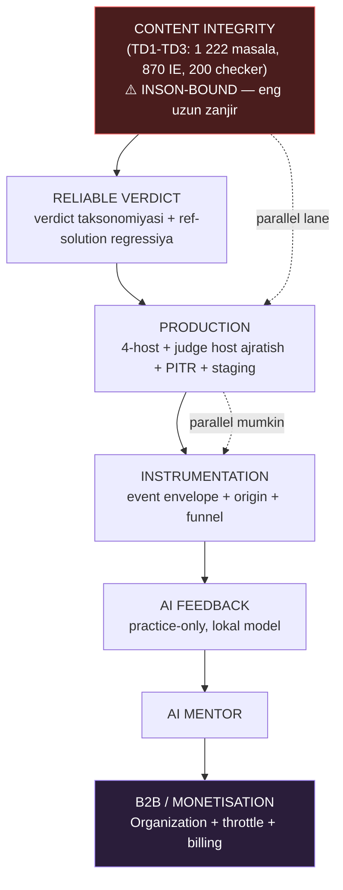

### 25.1 Critical path tekshiruvi (repo daliliga qarshi)

| Savol | Javob | Dalil |
|---|---|---|
| Product Strategy critical path: **TRUST TRUNK** eng uzunmi? | ✅ **Tasdiqlanadi** | Kontent remediatsiyasi **inson-bound**; 1 222 + 870 + 200 = ~2 300 element |
| PROD trunk parallel bora oladimi? | ✅ **Ha, qisman** | Staging, PITR, secrets, `security.yml` — kontentga **bog'liq emas**. Lekin **judge host ajratish** (M6) production trafigini talab qiladi |
| AI **kontentsiz** boshlana oladimi? | ❌ **Yo'q** | AI feedback verdiktga tayanadi; verdikt ishonchsiz bo'lsa feedback **noto'g'ri testga asoslanadi** (PS §5.5) |
| Instrumentation AI'dan **oldin** bo'lishi shartmi? | ✅ **Ha** | AI metrikasi (FAR/HR/CPF) eval harness'ga tayanadi; harness Phase 2 da |
| B2B eng oxirdami? | ⚠️ **Shartli** | Throttle (TD14) B2B dan **oldin**; lekin B2B **classroom hardening** va object-level authz (TD17) talab qiladi — bu **Phase 0/1** da boshlanishi mumkin |

### 25.2 Critical path'ni **qisqartiruvchi** richaglar

| Richag | Ta'sir | Sabab |
|---|---|---|
| **Ref-solution regressiya testi** (`print('3 2 1')` → AC **bo'lmasin**) | Trust trunk'ni **o'lchanadigan** qiladi | Bugun "1 222 masala" — progressni o'lchash yo'li **yo'q** |
| **Readiness holat mashinasi** | Remediatsiyani **kuzatiladigan** qiladi | "Nechtasi tuzatildi?" savoliga javob |
| **Compile cache** | Judge throughput'ni kontentga **bog'liq bo'lmagan** yo'l bilan oshiradi | Trust trunk bilan **parallel** boradi |
| **Staging** | Production xavfini kamaytiradi | Kontentsiz ham mumkin |
| **Data origin** | Instrumentation'ni **blokdan** chiqaradi | Usiz funnel iflos |

**INFERENCE (muhim):** eng katta **yashirin** risk — remediatsiya **throughput'i o'lchanmagan** (PS §7.2 ASSUMPTION). Agar author throughput past bo'lsa, butun critical path cho'ziladi. **RECOMMENDATION:** Phase 0 **birinchi** ishi — remediatsiya **throughput o'lchovi** (kuniga nechta masala), keyin reja.

---

## 26. Open Technical Questions

| # | Savol | Nega muhim | Yopish uchun nima kerak | Kim |
|---|---|---|---|---|
| Q1 | **Production'dagi real concurrent submission capacity qancha?** | Contest NFR 50/s; bench 8/s | Real yuk ostida o'lchov (production yoki staging, 4-host) | Eng/Ops |
| Q2 | **Throttle: `60/min` yoki `1500/hour`?** (CONFLICT-1) | B2B ochilishi shunga bog'liq | 20+ parallel user, 1 IP, joriy konfiguratsiya bilan qayta o'lchov | Backend + Ops |
| Q3 | **Data origin mexanizmi: `is_seeded` boolean yoki `origin` enum?** | Barcha metrikalar | ADR 0030 qarori + backfill evristikasi tasdig'i | Data + Eng |
| Q4 | **Sentry qarori qayta ko'riladimi?** (CONFLICT-4) | Kuzatuv **yoki** qaror buzilishi | Product Owner qarori; agar "yo'q" bo'lsa — Product Strategy F70 yangilanadi | Product + Eng |
| Q5 | **Staging mavjudmi?** (CONFLICT-3) | Hujjat va infratuzilma ziddiyati | ADR 0040 + host qarori | Ops |
| Q6 | **Bitta mashina production yuk ostida 7B modelni ko'taradimi?** | Phase 3 ni **bloklaydi** | GPU/RAM o'lchovi, load ostida benchmark | AI Eng |
| Q7 | **`privileged` siz nsjail ishlaydimi?** | TD4 xavfi | Prototip: systemd `Delegate=yes` + userns; bake-off 25 case qayta o'tkaziladi | Judge Eng |
| Q8 | **Judge host soni va GPU host?** | Contest sig'imi | Contest kalendari + capacity model | Ops |
| Q9 | **`judge-py` saqlanadimi?** | Kod yuki; ADR-0004 ochiq savoli | ADR qarori (bake-off B ni saqlash yoki chiqarish) | Judge Eng |
| Q10 | **`ReferenceSolution` per-problem yoki per-subtask?** (D5) | Subtask/partial grading | ADR (ADR-0010/0021 kengaytmasi) | Eng |
| Q11 | **seccomp profili qanday bo'ladi?** | TD4 | Profil loyihasi + bake-off | Judge Eng |
| Q12 | **Redis 3 rolni qachon ajratamiz?** | Nosozlik radiusi | Trigger: navbat > 1 000 YOKI CPU > 70% YOKI session eviction | Ops |
| Q13 | **Verdikt ustuvorlik tartibi qanday?** (PS F05 talabi) | Feedback ishonchliligi | Hujjat + test | Judge Eng |
| Q14 | **Denormalizatsiya counter sync mexanizmi?** (PS §12.4) | Ma'lumot izchilligi | D8: audit command + yagona yo'l | Eng |
| Q15 | **`rankwant.uz` ro'yxatdan o'tganmi?** | Brend/onboarding | Domen holati tekshiruvi | Product + Legal |
| Q16 | **`neytron_*` 10 001 seed user o'chiriladimi?** (ADR-0023 ochiq follow-up) | Indeksatsiya + crawl yuki; TD10 backfill | Backup + o'chirish qarori | Ops + Eng |
| Q17 | **Cloudflare darajasida rate limit qoidasi kerakmi?** | Repo'da qoida **yo'q**; WAF kod qatlamidan oldin ishlaydi | Qaror + qoida fayli | Ops |
| Q18 | **`as` rlimit 16 GB — kerakmi?** | Resurs iste'moli | O'lchov: eng katta real ish to'plami | Judge Eng |
| Q19 | **AI Gateway alohida servis yoki modul?** | Ops murakkabligi | ADR 0033 qarori (boshlanish modul bo'lishi mumkin) | Eng |
| Q20 | **Content remediatsiya throughput'i qancha?** | Critical path uzunligi | O'lchov: kuniga nechta masala validated | Content Ops |

---

## Appendix A — Diagram index

| Diagram | Bo'lim | Turi |
|---|---|---|
| System Context | 3.1 | Mermaid graph |
| Container / Component (As-Is) | 3.2 | Mermaid graph |
| Deployment (As-Is) | 3.5 | Mermaid graph |
| Target — 13 qatlam | 6.1 | Jadval |
| Target — konteyner/komponent | 6.2 | Mermaid graph |
| Dependency Map (BC) | 7.2 | Mermaid graph |
| Submission → Verdict flow | 11.1 | Mermaid sequenceDiagram |
| AI Feedback flow | 12.5 | Mermaid sequenceDiagram |
| Trust boundaries | 14.1 | Mermaid graph |
| Production topology (Current → Target) | 15.1 | Mermaid graph |
| B2B model | 17.1 | Mermaid graph |
| Billing boundary | 18.2 | Mermaid graph |
| Event pipeline | 13.5 | Mermaid graph |
| Critical path | 25 | Mermaid graph |

## Appendix B — Hujjatda ishlatilgan kod havolalari (tekshirilgan)

| Yo'l | Nima uchun |
|---|---|
| `apps/api/config/settings.py:40-71` | 19 app |
| `apps/api/config/settings.py:278-314` | 12 throttle scope |
| `apps/api/config/settings.py:411-470` | Celery beat jadvali |
| `apps/api/core/throttling.py:34-70` | `TrustedClientIdent`, `CacheOutageTolerant`, `InternalRenderRate` |
| `apps/api/core/permissions.py:20-23,46-99` | Staff guruhlar + permission klasslar |
| `apps/api/core/models.py:619` | `AnalyticsEvent` |
| `apps/api/qvant/ledger.py:64-131,197` | Ledger yagona yozuv yo'li + `verify_balance` |
| `apps/api/judging/services.py:202-260` | `apply_result` (idempotent) |
| `apps/api/judging/tasks.py:63-118` | `reap_stuck` |
| `apps/api/judging/provider.py:84-96` | Redis PULL provider |
| `services/judge-go/main.go:24-115` | Judge loop + `DATABASE_URL` rad etish |
| `services/judge-go/sandbox.go:220-308,349-366` | nsjail + cgroup v2 |
| `services/judge-go/protocol.go:184-209` | Verdict kodlari |
| `docker-compose.yml:192-193` | `privileged:true` + `cgroup:host` |
| `docker-compose.yml:39,69,92,106,136,151,199` | Dev-default sirlar |
| `tools/check_security_boundary.py:53,182,210-220` | Chegara gate |
| `tools/check_decisions.py:1392-1418` | Sentry/Kafka/K8s qarori |
| `tools/backup.sh:24-28,259-313` | Off-site OFF + restore testi |
| `.github/workflows/security.yml:32` | `if: false` |
| `compose/four-host/README.md` | Maqsad topologiya |
| `docs/06-architecture/README.md:117-123,143-163` | Staging ziddiyati + 5 ochiq savol |

## Appendix C — Bu hujjat nima qilmadi

- ❌ Kod yozmadi · ❌ refactor qilmadi · ❌ migratsiya yaratmadi · ❌ DB o'zgartirmadi · ❌ fayl o'chirmadi
- ❌ Product Strategy'ni o'zgartirmadi (faqat 5 ziddiyatni **ko'rsatdi**)
- ❌ Mavjud komponentni **taxmin bilan** "yomon" demadi
- ❌ Microservice qo'shmadi
- ❌ Muddat yozmadi
- ❌ ADR fayllarini yozmadi (faqat **inventory** — 21-bo'lim)
- ❌ Production readiness'ni **diagramma bilan isbotlangan** deb hisoblamadi — har da'vo o'lchovga yoki kod havolasiga bog'langan

---

> **Keyingi qadam (Engineering uchun):** ① 4-bo'limdagi 5 ziddiyat bo'yicha qaror · ② 21-bo'limdagi ADR 0037, 0030, 0028, 0029, 0044, 0032 ni yozish · ③ 24-bo'lim Phase 0 done condition'larini bajarish.
>
> **Product Owner tasdig'i kerak:** CONFLICT-1 (throttle raqami) · CONFLICT-4 (Sentry qarori) · CONFLICT-3 (staging) · Q2 · Q4 · Q5.
>
> Bu hujjat Software Architect Team tomonidan AI hamkorligida tayyorlandi; muhim qarorlar Saidakbar aka (Product Owner) tomonidan tasdiqlanishi kerak.

